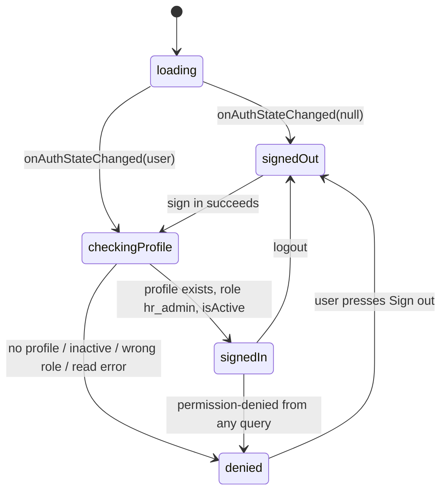

# Document 4 — Firebase Authentication, Authorization & Security Rules Plan

Schema: [FIRESTORE_DATABASE_DESIGN.md](FIRESTORE_DATABASE_DESIGN.md). Constants: [README.md §4](README.md). Tests: [BUSINESS_RULES_AND_TEST_CASES.md](BUSINESS_RULES_AND_TEST_CASES.md) (TC-RULES-*).

> **Status of the rules in this document: designed, not yet executed.** The rules below were written against the Firestore Security Rules language reference and checked by hand. They have **not** been run in the emulator (no emulator exists yet). Phase 2 (`users` + base rules) and Phase 6 (employees, types, balances, ledger) must prove them with automated tests before any UI depends on them. Constructs that must be verified are listed in §6.7.

---

## 1. Security goals and threat model

| Goal | How |
|---|---|
| Only an authorized, active HR user can read or write any data | Rules: `isHrAdmin()` on every collection, evaluated per request against `users/{uid}` |
| UI hiding is never the security boundary | Rules enforce every restriction; route guards are UX only **[Confirmed]** |
| Nobody can self-register or self-promote | Sign-up disabled; `users` cannot be created by clients; role cannot be changed by clients |
| History cannot be silently altered | Ledger: create-only, one permitted link update, no delete; balances only change together with a matching ledger entry |
| Balances cannot be corrupted | Rules recompute `before + delta = after` and `available = total − used ≥ 0` server-side |
| No privileged secrets in the frontend | Only public Firebase web config in the bundle |

**Actors considered:** (1) anonymous internet user holding the public API key; (2) a signed-in user with no/inactive profile; (3) an active HR admin using a modified client (devtools, scripts); (4) a stale or duplicated browser tab; (5) an HR admin who makes honest mistakes.

**Not defended against (see §9):** a malicious *active* HR admin writing a valid but dishonest entry; compromise of the Firebase console / project owner.

## 2. Firebase Authentication configuration

| Setting | Value | Notes |
|---|---|---|
| Sign-in providers | **Email/Password: ON**. Email link (passwordless): OFF. All others OFF | |
| Self sign-up | **Disabled** — Authentication → Settings → *User actions* → untick *Enable create (sign-up)* | Calls to sign up then fail with `auth/admin-restricted-operation`. Verify the label wording in the console; also leave *Enable delete* off |
| Authorized domains | `localhost` + the production hosting domain(s) only | |
| Email enumeration protection | ON (default for new projects; verify) | Generic errors for reset and sign-in |
| Password policy | Minimum length 8 (optionally require mixed case/number), if the console offers it | App also validates ≥ 8 on change |
| Multi-factor authentication | Not in MVP | Recommended post-MVP hardening |
| Persistence | Default `browserLocalPersistence` (session survives refresh and browser restart) | **[Confirmed]** |

### 2.1 Initial HR administrator provisioning (manual, done by the project owner)

1. Firebase console → Authentication → Users → **Add user** (email + temporary password). Copy the **UID**.
2. Firestore → create the database in **production mode** (default deny), then deploy the rules (`firebase deploy --only firestore:rules`, run by the owner — not by the implementation phases).
3. Firestore → collection `users` → document ID = the UID, with fields exactly as DB §3.1:
   `uid` (string), `fullName` (string), `email` (string), `role` = `hr_admin` (string), `isActive` = `true` (boolean), `createdAt` and `updatedAt` (**timestamp** type).
4. The user signs in and uses *Forgot password* (or the owner shares the temporary password securely) to set a personal password.
5. Further HR users: repeat steps 1, 3, 4.
6. **Offboarding:** set `isActive = false` (takes effect on the user's very next request) and then disable or delete the Auth user.
7. **Break-glass:** if the only admin is locked out, the project owner edits `users/{uid}` or resets the password in the console.

The emulator uses a seed script/fixture helper in tests (Phase 2) instead of the console; it must never contain real credentials.

## 3. Client configuration vs privileged credentials

| | Firebase **web app config** | **Service account / Admin SDK credentials** |
|---|---|---|
| Contains | `apiKey`, `authDomain`, `projectId`, `appId` | Private key JSON |
| Secret? | **No.** It identifies the project; it is shipped to every browser. Security comes from Rules and Auth, not from hiding it | **Yes — full admin access that bypasses all Rules** |
| Where it lives | `VITE_*` variables (`.env.local`, hosting build env) | Never in this repo, never in `VITE_*`, never in the frontend. Not used at all in the MVP |
| If leaked | Harmless on its own (an attacker still cannot pass Rules) | Rotate immediately |

Vite inlines every variable prefixed `VITE_` into the public bundle — so **only** the four web-config values and the emulator flag use that prefix.

| Variable | Example | Committed? |
|---|---|---|
| `VITE_FIREBASE_API_KEY` | `AIza…` (real) / `demo-api-key` (emulator) | `.env.development`: demo value yes; real values only in untracked `.env.local` / CI settings |
| `VITE_FIREBASE_AUTH_DOMAIN` | `your-project.firebaseapp.com` | as above |
| `VITE_FIREBASE_PROJECT_ID` | `your-project` / `demo-hr-leave` | as above |
| `VITE_FIREBASE_APP_ID` | `1:123:web:abc` | as above |
| `VITE_USE_FIREBASE_EMULATORS` | `true` / `false` | `.env.development` = true |

`.env.example` documents the names (no values). `.gitignore` excludes `.env.local`, `.env.*.local`, `.env.production`, `service-account*.json`, `*.pem`, `.firebase/`. Environment values are validated at startup with Zod (`src/lib/env.ts`); a missing value renders a clear "Configuration error" screen, not a blank page.

**Optional hardening, not in MVP:** Firebase **App Check** (reCAPTCHA Enterprise) to reduce API abuse from non-app clients; restricting the API key by HTTP referrer in Google Cloud Console (recommended once the production domain is known).

## 4. Authorization model, client auth flow, and route protection

### 4.1 Model **[D-02]**

Authorization = a document at `users/{uid}` with `role == 'hr_admin'` and `isActive == true`. Rules fetch that document on every request (`get()`), so deactivation is immediate and no token refresh or custom claim is needed. Custom claims were rejected: they require the Admin SDK (a trusted server) to set, and revocation waits for token refresh.

### 4.2 Client auth state machine



`AuthProvider` (feature `auth`) exposes `{ status: 'loading'|'signedOut'|'signedIn'|'denied', user, profile, deniedReason, signIn, signOut, sendReset, refreshProfile }`. It subscribes to `onAuthStateChanged` once, reads `users/{uid}` once per sign-in with `getDoc` (no listener), and on `signOut` calls `queryClient.clear()` so no data survives on a shared machine.

### 4.3 Route protection

| Layer | Behaviour |
|---|---|
| `RequireAuth` layout route | `loading` → full-screen spinner; `signedOut` → `<Navigate to="/login" state={{from}}>`; `denied` → `/access-denied`; `signedIn` → `<Outlet/>` |
| `PublicOnly` wrapper (login, forgot) | Signed-in users are redirected to `/` |
| Global `permission-denied` handler (TanStack Query `QueryCache`/`MutationCache` `onError`) | Calls `refreshProfile()`; if no longer authorized → `denied` state |
| **Rules** | The real boundary — a user who bypasses the router still gets `permission-denied` |

### 4.4 Authentication workflows and error mapping

| Workflow | Behaviour |
|---|---|
| Login | `signInWithEmailAndPassword`; on success the provider verifies the profile. Button disabled while pending |
| Logout | `signOut`, clear caches, navigate to `/login` (history is replaced so Back cannot show app pages; the guard would block them anyway) |
| Password reset | `sendPasswordResetEmail`; **always** show "If an account exists for that email, a reset link has been sent." regardless of outcome (except `auth/invalid-email` and `auth/network-request-failed`) |
| Change password (Settings → Account) | Re-authenticate with the current password (`reauthenticateWithCredential`) then `updatePassword`; handle `auth/requires-recent-login` |
| Edit display name | `updateDoc(users/{uid}, {fullName, updatedAt})` — the only field rules allow |

| Firebase error | Message shown |
|---|---|
| `auth/invalid-credential`, `auth/wrong-password`, `auth/user-not-found` | "Incorrect email or password." (identical) |
| `auth/invalid-email` | "Enter a valid email address." |
| `auth/user-disabled` | "This account has been disabled. Contact your administrator." |
| `auth/too-many-requests` | "Too many attempts. Wait a few minutes or reset your password." |
| `auth/network-request-failed` | "Can't reach the server. Check your connection." |
| `auth/requires-recent-login` | Prompt for current password |
| `auth/weak-password` | "Choose a stronger password (at least 8 characters)." |
| `auth/admin-restricted-operation` | (never surfaced; there is no sign-up UI) |
| anything else | "Something went wrong. Try again." + console error without PII |

## 5. Rules foundation and the `users` collection

Rules structure: helper functions → one `match` block per collection → default deny (implicit: any path without a matching `allow` is denied; there is no catch-all).

`users/{uid}`:
- `get`: a signed-in user may read **their own** document even if inactive/misconfigured (so the app can show *Access Denied* rather than failing opaquely). No `list`.
- `create` / `delete`: **never** from clients (console only).
- `update`: only an active HR admin, only their own document, only `fullName` and `updatedAt`, `updatedAt == request.time`. Therefore `role`, `isActive`, `email`, `uid` cannot be changed by anyone through the app — **users cannot promote themselves**.

## 6. Firestore Security Rules — proposed implementation

### 6.1 Complete outline (`firestore.rules`)

Written in stages: Phase 2 deploys §6.1 helpers + `users` + a final deny for everything else; Phases 5, 4, and 6 add the remaining blocks, each with tests.

```
rules_version = '2';

service cloud.firestore {
  match /databases/{database}/documents {

    // ───────── constants & primitives ─────────
    function statuses() {
      return ['Regular', 'Probationary', 'Contractual', 'Project-Based', 'Part-Time']; // Q-01
    }
    function isStr(v, lo, hi)       { return v is string && v.size() >= lo && v.size() <= hi; }
    function isStrOrNull(v, lo, hi) { return v == null || isStr(v, lo, hi); }
    function isTrimmed(v)           { return v == v.trim(); }
    function exactKeys(d, keys)     { return d.keys().hasOnly(keys) && d.keys().hasAll(keys); }
    function validDays(v) {         // > 0, ≤ 365, multiple of 0.5  (DAY_STEP, MAX_DAYS_PER_ENTRY)
      return v is number && v > 0 && v <= 365 && int(v * 2) == v * 2;
    }
    function validYear(v)           { return v is int && v >= 2000 && v <= 2100; }
    function isoDate(v) {
      return v is string &&
        v.matches('^[0-9]{4}-(0[1-9]|1[0-2])-(0[1-9]|[12][0-9]|3[01])$');
    }

    // ───────── path helpers ─────────
    function empPath(id)  { return /databases/$(database)/documents/employees/$(id); }
    function numPath(key) { return /databases/$(database)/documents/employeeNumbers/$(key); }
    function typePath(id) { return /databases/$(database)/documents/leaveTypes/$(id); }
    function balPath(id)  { return /databases/$(database)/documents/leaveBalances/$(id); }
    function txnPath(id)  { return /databases/$(database)/documents/leaveTransactions/$(id); }

    // ───────── identity ─────────
    function signedIn() { return request.auth != null; }
    function profile()  { return get(/databases/$(database)/documents/users/$(request.auth.uid)).data; }
    function isHrAdmin() {
      return signedIn() && profile().role == 'hr_admin' && profile().isActive == true;
    }
    function me() { return request.auth.uid; }

    // ───────── users ─────────
    match /users/{uid} {
      allow get: if signedIn() && request.auth.uid == uid;
      allow list: if false;
      allow create, delete: if false;
      allow update: if isHrAdmin() && request.auth.uid == uid
        && request.resource.data.diff(resource.data).affectedKeys().hasOnly(['fullName', 'updatedAt'])
        && isStr(request.resource.data.fullName, 1, 100)
        && isTrimmed(request.resource.data.fullName)
        && request.resource.data.updatedAt == request.time;
    }

    // ───────── employees (6.2) ─────────
    function empKeys() {
      return ['employeeNumber', 'employeeNumberKey', 'fullName', 'position', 'department',
              'employmentStatus', 'isArchived', 'archivedAt', 'archivedBy',
              'createdAt', 'createdBy', 'updatedAt', 'updatedBy'];
    }
    function employeeShapeOk(d) {
      return exactKeys(d, empKeys())
        && d.employeeNumber is string
        && d.employeeNumber.matches('^[A-Za-z0-9][A-Za-z0-9._-]{0,29}$')       // R-07
        && d.employeeNumberKey == d.employeeNumber.upper()
        && isStr(d.fullName, 1, 120) && isTrimmed(d.fullName)
        && isStr(d.position, 1, 80)  && isTrimmed(d.position)
        && (d.department == null || (isStr(d.department, 1, 80) && isTrimmed(d.department)))
        && d.employmentStatus in statuses()
        && d.isArchived is bool
        && d.updatedAt == request.time && d.updatedBy == me();
    }
    function archiveStateOk(before, after) {
      return (after.isArchived == before.isArchived
              && after.archivedAt == before.archivedAt && after.archivedBy == before.archivedBy)
          || (before.isArchived == false && after.isArchived == true
              && after.archivedAt == request.time && after.archivedBy == me())
          || (before.isArchived == true && after.isArchived == false
              && after.archivedAt == null && after.archivedBy == null);
    }
    match /employees/{employeeId} {
      allow get, list: if isHrAdmin();
      allow create: if isHrAdmin()
        && employeeShapeOk(request.resource.data)
        && request.resource.data.isArchived == false
        && request.resource.data.archivedAt == null && request.resource.data.archivedBy == null
        && request.resource.data.createdAt == request.time && request.resource.data.createdBy == me()
        && !exists(numPath(request.resource.data.employeeNumberKey))
        && getAfter(numPath(request.resource.data.employeeNumberKey)).data.employeeId == employeeId;
      allow update: if isHrAdmin()
        && employeeShapeOk(request.resource.data)
        && request.resource.data.createdAt == resource.data.createdAt
        && request.resource.data.createdBy == resource.data.createdBy
        && archiveStateOk(resource.data, request.resource.data)
        && (request.resource.data.employeeNumberKey == resource.data.employeeNumberKey
            || (!exists(numPath(request.resource.data.employeeNumberKey))                  // R-04
                && getAfter(numPath(request.resource.data.employeeNumberKey)).data.employeeId == employeeId
                && !existsAfter(numPath(resource.data.employeeNumberKey))));
      allow delete: if false;                                                               // Confirmed
    }
    match /employeeNumbers/{key} {
      allow get: if isHrAdmin();
      allow list: if false;
      allow create: if isHrAdmin()
        && exactKeys(request.resource.data, ['employeeId', 'createdAt'])
        && request.resource.data.createdAt == request.time
        && existsAfter(empPath(request.resource.data.employeeId))
        && getAfter(empPath(request.resource.data.employeeId)).data.employeeNumberKey == key;
      allow update: if false;
      allow delete: if isHrAdmin()
        && existsAfter(empPath(resource.data.employeeId))
        && getAfter(empPath(resource.data.employeeId)).data.employeeNumberKey != key;
    }

    // ───────── leaveTypes (6.3) ─────────
    function typeKeys() {
      return ['name', 'description', 'isActive', 'createdAt', 'createdBy', 'updatedAt', 'updatedBy'];
    }
    function typeShapeOk(d) {
      return exactKeys(d, typeKeys())
        && isStr(d.name, 1, 60) && isTrimmed(d.name)
        && (d.description == null || (isStr(d.description, 1, 200) && isTrimmed(d.description)))
        && d.isActive is bool
        && d.updatedAt == request.time && d.updatedBy == me();
    }
    match /leaveTypes/{leaveTypeId} {
      allow get, list: if isHrAdmin();
      allow create: if isHrAdmin() && typeShapeOk(request.resource.data)
        && request.resource.data.createdAt == request.time && request.resource.data.createdBy == me();
      allow update: if isHrAdmin() && typeShapeOk(request.resource.data)
        && request.resource.data.createdAt == resource.data.createdAt
        && request.resource.data.createdBy == resource.data.createdBy;
      allow delete: if false;
    }

    // ───────── ledger helpers (shared by 6.4 and 6.5) ─────────
    function ledgerAfter(id) { return getAfter(txnPath(id)).data; }
    function balanceAfter(id) { return getAfter(balPath(id)).data; }

    // ───────── leaveBalances (6.4) ─────────
    function balKeys() {
      return ['employeeId', 'leaveTypeId', 'year', 'totalCredits', 'totalUsed', 'availableCredits',
              'lastTransactionId', 'createdAt', 'updatedAt'];
    }
    // Checks that hold for both create and update of a balance.
    function balanceLinkedToNewLedger(balanceId, d) {
      return exactKeys(d, balKeys())
        && validYear(d.year)
        && d.employeeId is string && d.leaveTypeId is string
        && balanceId == d.employeeId + '_' + string(d.year) + '_' + d.leaveTypeId
        && d.lastTransactionId is string
        && d.lastTransactionId.matches('^(rev_)?[A-Za-z0-9]{20}$')
        && !exists(txnPath(d.lastTransactionId))        // the ledger entry is NEW in this commit
        && existsAfter(txnPath(d.lastTransactionId))    // …and it is being written in this commit
        && ledgerAfter(d.lastTransactionId).balanceId == balanceId
        && ledgerAfter(d.lastTransactionId).employeeId == d.employeeId
        && ledgerAfter(d.lastTransactionId).leaveTypeId == d.leaveTypeId
        && ledgerAfter(d.lastTransactionId).leaveYear == d.year
        && d.availableCredits == d.totalCredits - d.totalUsed
        && d.totalCredits >= 0 && d.totalUsed >= 0 && d.availableCredits >= 0
        && d.updatedAt == request.time;
    }
    match /leaveBalances/{balanceId} {
      allow get, list: if isHrAdmin();
      allow create: if isHrAdmin()
        && balanceLinkedToNewLedger(balanceId, request.resource.data)
        && request.resource.data.createdAt == request.time
        && request.resource.data.totalCredits == ledgerAfter(request.resource.data.lastTransactionId).creditsDelta
        && request.resource.data.totalUsed    == ledgerAfter(request.resource.data.lastTransactionId).usedDelta;
      allow update: if isHrAdmin()
        && balanceLinkedToNewLedger(balanceId, request.resource.data)
        && request.resource.data.createdAt == resource.data.createdAt
        && request.resource.data.employeeId == resource.data.employeeId
        && request.resource.data.leaveTypeId == resource.data.leaveTypeId
        && request.resource.data.year == resource.data.year
        && request.resource.data.totalCredits ==
             resource.data.totalCredits + ledgerAfter(request.resource.data.lastTransactionId).creditsDelta
        && request.resource.data.totalUsed ==
             resource.data.totalUsed + ledgerAfter(request.resource.data.lastTransactionId).usedDelta;
      allow delete: if false;
    }

    // ───────── leaveTransactions (6.5) ─────────
    function ledgerKeys() {
      return ['employeeId', 'employeeNumberSnapshot', 'employeeNameSnapshot', 'positionSnapshot',
              'departmentSnapshot', 'leaveTypeId', 'leaveTypeNameSnapshot', 'leaveYear', 'balanceId',
              'transactionType', 'days', 'creditsDelta', 'usedDelta', 'dateFrom', 'dateTo', 'remarks',
              'reversesTransactionId', 'reversesType', 'reversedByTransactionId',
              'resultingTotalCredits', 'resultingTotalUsed', 'createdBy', 'createdByName', 'createdAt'];
    }
    // ALLOCATION / USAGE: snapshots must match current master data; employee active; type active.
    function masterDataOk(d) {
      return get(empPath(d.employeeId)).data.isArchived == false
        && get(typePath(d.leaveTypeId)).data.isActive == true
        && d.employeeNumberSnapshot == get(empPath(d.employeeId)).data.employeeNumber
        && d.employeeNameSnapshot   == get(empPath(d.employeeId)).data.fullName
        && d.positionSnapshot       == get(empPath(d.employeeId)).data.position
        && d.departmentSnapshot     == get(empPath(d.employeeId)).data.department
        && d.leaveTypeNameSnapshot  == get(typePath(d.leaveTypeId)).data.name;
    }
    function allocationOk(d) {
      return d.creditsDelta == d.days && d.usedDelta == 0
        && d.dateFrom == null && d.dateTo == null
        && d.reversesTransactionId == null && d.reversesType == null
        && masterDataOk(d);
    }
    function usageOk(d) {
      return d.usedDelta == d.days && d.creditsDelta == 0
        && isoDate(d.dateFrom) && isoDate(d.dateTo) && d.dateFrom <= d.dateTo
        && d.dateFrom.matches('^' + string(d.leaveYear) + '-.*')
        && d.dateTo.matches('^' + string(d.leaveYear) + '-.*')
        && d.reversesTransactionId == null && d.reversesType == null
        && masterDataOk(d);
    }
    // REVERSAL: mirror of the original, linked both ways in the same commit (R-02, R-03).
    function reversalOk(txnId, d) {
      return d.reversesTransactionId is string
        && txnId == 'rev_' + d.reversesTransactionId
        && d.remarks is string && d.remarks.size() >= 3
        && exists(txnPath(d.reversesTransactionId))
        && get(txnPath(d.reversesTransactionId)).data.transactionType in ['ALLOCATION', 'USAGE']
        && get(txnPath(d.reversesTransactionId)).data.reversedByTransactionId == null
        && ledgerAfter(d.reversesTransactionId).reversedByTransactionId == txnId
        && d.reversesType == get(txnPath(d.reversesTransactionId)).data.transactionType
        && d.balanceId   == get(txnPath(d.reversesTransactionId)).data.balanceId
        && d.employeeId  == get(txnPath(d.reversesTransactionId)).data.employeeId
        && d.leaveTypeId == get(txnPath(d.reversesTransactionId)).data.leaveTypeId
        && d.leaveYear   == get(txnPath(d.reversesTransactionId)).data.leaveYear
        && d.days        == get(txnPath(d.reversesTransactionId)).data.days
        && d.creditsDelta == -get(txnPath(d.reversesTransactionId)).data.creditsDelta
        && d.usedDelta    == -get(txnPath(d.reversesTransactionId)).data.usedDelta
        && d.dateFrom == get(txnPath(d.reversesTransactionId)).data.dateFrom
        && d.dateTo   == get(txnPath(d.reversesTransactionId)).data.dateTo
        && d.employeeNumberSnapshot == get(txnPath(d.reversesTransactionId)).data.employeeNumberSnapshot
        && d.employeeNameSnapshot   == get(txnPath(d.reversesTransactionId)).data.employeeNameSnapshot
        && d.positionSnapshot       == get(txnPath(d.reversesTransactionId)).data.positionSnapshot
        && d.departmentSnapshot     == get(txnPath(d.reversesTransactionId)).data.departmentSnapshot
        && d.leaveTypeNameSnapshot  == get(txnPath(d.reversesTransactionId)).data.leaveTypeNameSnapshot;
    }
    function ledgerCreateOk(txnId, d) {
      return exactKeys(d, ledgerKeys())
        && txnId.matches('^(rev_)?[A-Za-z0-9]{20}$')
        && (d.transactionType == 'REVERSAL' ? txnId.matches('^rev_.*') : !txnId.matches('^rev_.*'))
        && d.createdBy == me() && d.createdAt == request.time && d.createdByName == profile().fullName
        && validYear(d.leaveYear) && validDays(d.days)
        && (d.remarks == null || isStr(d.remarks, 1, 500))
        && d.employeeId is string && d.leaveTypeId is string
        && d.balanceId == d.employeeId + '_' + string(d.leaveYear) + '_' + d.leaveTypeId
        && d.reversedByTransactionId == null
        // ── atomic pairing with the balance ──
        && existsAfter(balPath(d.balanceId))
        && balanceAfter(d.balanceId).lastTransactionId == txnId
        && balanceAfter(d.balanceId).totalCredits == d.resultingTotalCredits
        && balanceAfter(d.balanceId).totalUsed    == d.resultingTotalUsed
        // ── per-type semantics ──
        && ((d.transactionType == 'ALLOCATION' && allocationOk(d))
            || (d.transactionType == 'USAGE'    && usageOk(d))
            || (d.transactionType == 'REVERSAL' && reversalOk(txnId, d)));
    }
    // The single permitted update: link an original to its reversal, once.
    function ledgerLinkOk(txnId, before, after) {
      return after.diff(before).affectedKeys().hasOnly(['reversedByTransactionId'])
        && before.reversedByTransactionId == null
        && before.transactionType in ['ALLOCATION', 'USAGE']
        && after.reversedByTransactionId == 'rev_' + txnId
        && !exists(txnPath('rev_' + txnId))
        && existsAfter(txnPath('rev_' + txnId))
        && ledgerAfter('rev_' + txnId).transactionType == 'REVERSAL'
        && ledgerAfter('rev_' + txnId).reversesTransactionId == txnId;
    }
    match /leaveTransactions/{txnId} {
      allow get, list: if isHrAdmin();
      allow create: if isHrAdmin() && ledgerCreateOk(txnId, request.resource.data);
      allow update: if isHrAdmin() && ledgerLinkOk(txnId, resource.data, request.resource.data);
      allow delete: if false;
    }
  }
}
```

### 6.2 Notes on `employees` / `employeeNumbers`

- Create: the employee and its reservation are written in one commit, each rule checking the other with `getAfter()`. A duplicate Employee ID fails because the reservation already exists (`!exists` on the employee side; create-vs-update on the reservation side).
- Employee ID change **[R-04]**: new reservation created, old deleted, employee updated — all in one commit; each of the three rules verifies the others.
- A client cannot create a reservation for a key the employee doesn't use, nor delete a reservation that is still in use.

### 6.3 Notes on `leaveTypes`

Shape validation only. Name uniqueness is not rules-enforced **[A-05]**. Deactivation is a normal `update` of `isActive`.

### 6.4 `leaveBalances` — what the rule proves

For a balance write to succeed, **in the same commit** there must be a ledger entry that: did not previously exist; is being created; points at this exact balance (same ID, employee, type, year); and whose signed deltas turn the *current stored* totals (`resource.data`, evaluated server-side at commit) into the *proposed* totals. Plus `available = total − used` and none negative. A stale client cannot slip a wrong total through, because the "before" comes from the server, not the client.

### 6.5 `leaveTransactions` — what the rule proves

For a ledger create to succeed, **in the same commit** the balance it targets must be written with `lastTransactionId == this entry`, and the balance's new totals must equal the totals recorded on the entry. Type-specific checks fix the sign of both deltas, the date/year constraints, the active/archived status, the snapshot values, and — for reversals — the exact mirror of the original plus the back-link. The two directions of binding (§6.4 and §6.5) mean **neither document can be written without the other**.

### 6.6 Access-call budget (R-08)

Firestore limits `get`/`exists`/`getAfter`/`existsAfter` calls to **10 per operation** and **20 per multi-document request** (transactions and batches); repeated calls to the same document may be cached and not counted. Exceeding either limit is a `permission-denied`.

Estimated worst case (no caching assumed):

| Commit | Writes | Estimated calls (per write → total) |
|---|---|---|
| Allocation / usage | ledger create + balance write | ≈ 6 + 5 → **≈ 11** |
| Reversal | reversal create + balance update + original update | ≈ 8 + 5 + 4 → **≈ 17** |
| Employee create | employee + reservation | ≈ 3 + 3 → ≈ 6 |

The reversal commit is closest to the limit. The `masterDataOk` and `reversalOk` helpers repeat `get()` of the same documents, which Firestore should cache, but this must be **measured in Phase 6 before building UI**. If a limit is exceeded, apply in order:
1. *(pre-approved)* Drop the snapshot equality checks (keep the archived/active checks) — saves ≈ 4 calls. Cost: snapshot truthfulness is no longer rules-enforced (audit data only; balances unaffected).
2. *(pre-approved)* Drop `reversesType` equality and the date copies on reversals (display-only fields).
3. *(needs user approval)* Bind the reversal to the balance only and verify the original's link via the balance's `lastTransactionId` and reversal ID shape. Cost: a reversal would no longer be proven to mirror its original.
4. *(needs user approval)* As a last resort, move writes to a Cloud Function (requires the Blaze plan) — a recorded deviation from D-01.

Steps 1–2 weaken only audit/display fields and may be applied without asking (log them as `APPROVED (pre-approved fallback)`). Steps 3–4 weaken integrity guarantees or change D-01 and **require the user's approval**. The ledger↔balance pairing and the arithmetic checks are never removed.

Rules `get()` calls are billed as document reads: expect ≈ 4–8 extra reads per ledger commit (§DB 11). Negligible at MVP scale.

### 6.7 Constructs to verify in the emulator (Phase 2/6 gate)

| # | Construct | Why it matters | If unsupported |
|---|---|---|---|
| V-1 | `string(v.year)` yields `"2026"` for an **int** (and `"2026.0"` for a float) | Deterministic balance ID check | Store a string `yearKey` on balance and ledger |
| V-2 | `int(v * 2) == v * 2` for `v` = 0.5, 1, 2.5 (true) and 2.3 (false); int-vs-float equality | Half-day step | Use `v % 0.5 == 0` or `v * 2 == math.floor(v * 2)` after confirming support |
| V-3 | `request.resource.data.diff(resource.data).affectedKeys().hasOnly([...])` | Users / ledger link updates | Compare each field explicitly |
| V-4 | `getAfter`/`existsAfter` see other writes in the same transaction | The whole binding | — (core; would invalidate D-03 and require a deviation) |
| V-5 | `!exists(x)` is evaluated against the pre-commit state | Prevents pointing a balance at an old ledger entry | — (core) |
| V-6 | Ternary and `let`-free helper functions compile as written; `'^' + string(n) + '-.*'` regex building | Date/year checks | Rewrite without ternary / compute year string once |
| V-7 | Unary minus on a field (`-x.creditsDelta`) and `a == -b` | Reversal mirror | Use `a + b == 0` |
| V-8 | Call counts per commit (§6.6) | Limits | Fallback ladder in §6.6 |
| V-9 | Null comparisons: `d.dateFrom == null` for explicit `null` fields | Fixed document shape | Use `d.dateFrom == null` vs `!('dateFrom' in d)` consistently |
| V-10 | String ordering `d.dateFrom <= d.dateTo` for `YYYY-MM-DD` strings | `dateFrom ≤ dateTo` | Compare year/month/day parts via `split('-')` and `int()` |

If any *core* item (V-4, V-5) fails, **stop and report** (handoff rule): the architecture, not a detail, would be affected.

## 7. Rules validation: attack scenarios

Each row must become a rules test (TC-RULES-*) in Document 7.

| # | Attempt (by an active HR admin with a modified client unless stated) | Why it is denied |
|---|---|---|
| 1 | Anonymous read/write of any collection | `isHrAdmin()` requires auth |
| 2 | Signed-in user with no `users` doc / `isActive:false` / `role:'x'` reads or writes | `profile()` missing or fails the predicate |
| 3 | User updates own `role` or `isActive`; creates own profile; deletes it | `affectedKeys().hasOnly(['fullName','updatedAt'])`; create/delete `false` |
| 4 | Write a ledger entry **without** updating the balance | `existsAfter(balance)` / `lastTransactionId == txnId` fails |
| 5 | Update a balance **without** a ledger entry (e.g., set `totalCredits: 999`) | `!exists`/`existsAfter(ledger)` fails |
| 6 | Update a balance pointing `lastTransactionId` at an **old** ledger entry to replay its delta | `!exists(txnPath(lastTransactionId))` (the entry already exists) |
| 7 | Ledger says +10 credits, balance written +11 | `totalCredits == resource.data.totalCredits + creditsDelta` |
| 8 | Usage larger than available | `availableCredits >= 0` on the proposed balance |
| 9 | Usage that would create a brand-new balance | New balance would have `totalUsed > totalCredits` → `availableCredits < 0` |
| 10 | Edit a ledger entry's `days`, `remarks`, deltas, etc. | Update permits only `reversedByTransactionId`, once, to `rev_{id}` with a matching reversal in the commit |
| 11 | Delete any ledger entry, balance, employee, or leave type | `allow delete: if false` |
| 12 | Reverse the same entry twice | `rev_{id}` already exists (create-only) and `reversedByTransactionId` already set |
| 13 | Reverse a reversal | Original must be `ALLOCATION`/`USAGE` |
| 14 | Reverse an allocation whose credits are partly used (available would go negative) | Balance `availableCredits >= 0` |
| 15 | Reversal with altered `days`/deltas/dates | `reversalOk` mirror checks |
| 16 | Allocate/use for an archived employee or inactive type | `masterDataOk` |
| 17 | Wrong year / dates outside the year / `dateFrom > dateTo` / malformed dates | `usageOk`, `validYear`, `isoDate` |
| 18 | 0, negative, 0.3, or 366 days | `validDays` |
| 19 | Wrong sign: `USAGE` with `creditsDelta ≠ 0`, `ALLOCATION` with `usedDelta ≠ 0` | `allocationOk` / `usageOk` |
| 20 | Spoof `createdBy`, `createdByName`, or `createdAt` | `== me()`, `== profile().fullName`, `== request.time` |
| 21 | Two ledger entries in one commit pointing at one balance | Only one entry can equal `balance.lastTransactionId` |
| 22 | Balance ID not matching employee/year/type | `balanceId == employeeId + '_' + string(year) + '_' + leaveTypeId` |
| 23 | Create an employee with an existing Employee ID (any case) | Reservation exists → denied |
| 24 | Create a reservation for a key the employee doesn't use / delete a reservation still in use | `getAfter(employee).employeeNumberKey` checks |
| 25 | Extra or missing fields on any document | `exactKeys` |
| 26 | Two tabs submit simultaneously against one balance | Server-side optimistic concurrency: one commit succeeds, the other retries with fresh reads (SDK) and either succeeds with correct totals or fails the overdraft check. The rule's `before` is the server state, so a stale total can never be committed |
| 27 | Same transaction ID submitted twice | Create-only: second attempt is an update → denied; the client sees "duplicate" and treats it as success (DB §6.4) |
| 28 | Active user deactivated mid-session | Next request fails `isActive` → client handles `permission-denied` (§4.3) |

## 8. What Security Rules can and cannot enforce

| Enforced by **Rules** (server-side, tamper-proof) | Enforced by **client transaction code** (helpful, not authoritative) | **Cannot** be enforced without trusted backend code |
|---|---|---|
| Authentication + active HR role | Reading and recomputing balances | Atomic "reverse **and** re-record" as one commit |
| Document shapes, types, lengths, enums | Friendly validation messages (Zod) | Per-user rate limiting / abuse throttling |
| Ledger immutability and the reversal link | Idempotency pre-check (`duplicate`) | Uniqueness of leave-type names (not worth a reservation doc) |
| Arithmetic: `before + delta = after`, `available ≥ 0` | Overlap detection for leave dates | `days ≤ inclusive calendar days` (needs date arithmetic) |
| Day step (0.5), cap (365), year range, date format | Real-calendar-date validation (e.g., 2026-02-31) | Detecting an HR admin who records a *valid but false* entry |
| Atomic ledger ↔ balance pairing | Reconciliation checks before export | Scheduled backups, alerting, server-side audit trail |
| Employee ID uniqueness, no deletes | Archive/restore UX, confirmations | Enforcing that the stated reason in a reversal is meaningful |

## 9. Client-only architecture: security and integrity trade-offs (D-01)

**Why acceptable for the MVP:** one trusted role, small data, strict rules that verify arithmetic and links server-side, immutable history, free tier.

**Residual risks / trade-offs**
1. **Intent is not verifiable.** Rules guarantee consistent, traceable entries — not that an HR admin entered the *right* ones. Mitigation: attribution on every entry, immutable history, reversal-only corrections.
2. **Public API key abuse.** Anyone can call Auth/Firestore endpoints with the key; Rules and disabled sign-up bound the damage; App Check / referrer restrictions are optional hardening.
3. **Rules complexity.** The cross-document bindings are the most intricate part of the system (RK-01). Mitigated by the Phase 2/6 test gates and the fallback ladder (§6.6).
4. **Two-commit corrections** (RK-07).
5. **No server-side audit log or alerting.** The ledger is the audit trail; there is no notification of suspicious activity.
6. **Backups.** The Spark plan has no scheduled backups/PITR (believed; verify, A-08). Mitigation: regular Excel exports; upgrade to Blaze with a budget alert if scheduled backups are required (RK-05).
7. **Console access = full power.** Anyone with project Owner/Editor can bypass Rules. Restrict console roles.
8. **Dependency supply chain** (npm, SheetJS CDN tarball): lockfile committed, `npm audit` in Phase 12, pinned tarball URL (RK-06).

**Where Cloud Functions would help later:** user management UI (create/disable HR users), atomic replace-entry callable, scheduled Firestore exports, email alerts, server-validated report generation. Each needs the Blaze plan and would be a documented evolution of D-01.

## 10. Frontend security practices

- React escapes output; **no `dangerouslySetInnerHTML`**. Remarks are plain text everywhere, including Excel (FR-RPT-07: always string cells).
- No secrets, tokens, or PII in logs; error logging records codes only.
- `queryClient.clear()` on logout; no sensitive data in `localStorage` (only UI preferences such as table page size).
- Autocomplete attributes on login (`email`, `current-password`, `new-password`); password fields never logged.
- Hosting (Phase 12 checklist, not built now): HTTPS only, SPA rewrite, security headers (CSP restricting scripts to self + Google APIs, `X-Content-Type-Options`, `Referrer-Policy`, frame-ancestors none).
- Dependencies pinned via lockfile; `npm audit` reviewed in Phase 12.

## 11. Rules testing plan (summary — cases in Document 7)

Harness: `@firebase/rules-unit-testing` with the Firestore emulator (project `demo-hr-leave`), run via `firebase emulators:exec`. Contexts: `anonymous`, `authedNoProfile`, `inactiveHr`, `wrongRole`, `hr` (active). Fixtures seed `users` via `withSecurityRulesDisabled`.

| Phase | Tests required before the phase is "complete" |
|---|---|
| 2 | All of TC-RULES-USR-*; deny-all for every other collection |
| 4 | TC-RULES-LT-* |
| 5 | TC-RULES-EMP-* (reservation create/swap/delete, no delete, archive transitions) |
| 6 | TC-RULES-LED-* (every ledger/balance attack row in §7; rows 1–3 and 28 are covered by TC-RULES-USR-*, rows 23–25 by TC-RULES-EMP-*), the V-1…V-10 verifications, and the call-budget measurement |
| 12 | Full suite re-run; index/production smoke test checklist |
