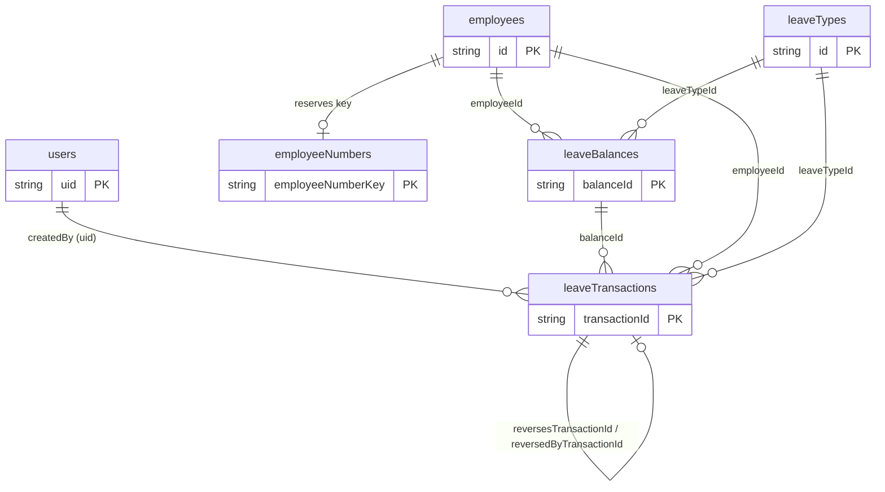

# Document 3 — Firestore Database Design

Canonical constants are in [README.md §4](README.md). Rules that enforce this schema are in [FIREBASE_SECURITY_PLAN.md](FIREBASE_SECURITY_PLAN.md). Business behaviour is in [BUSINESS_RULES_AND_TEST_CASES.md](BUSINESS_RULES_AND_TEST_CASES.md). **This document is authoritative for field names, types, and IDs.**

---

## 1. Design principles

1. **Ledger first.** `leaveTransactions` is an append-only ledger and the source of truth for history. `leaveBalances` is a *materialized* running total that is always updated in the same atomic commit as the ledger entry **[D-03]**.
2. **Top-level collections.** Year-wide and cross-employee queries (dashboard, reports, history) are the common case, so ledger and balances are top-level rather than sub-collections of `employees`.
3. **Deterministic IDs where uniqueness matters.** Balance IDs, reservation IDs, and reversal IDs are derived, so duplicates are impossible at the database level.
4. **Fixed document shapes.** Every document has all of its fields at all times (optional values are `null`, never absent). Rules use `hasOnly` + `hasAll` to reject extra or missing fields.
5. **Snapshots only where history needs them.** Ledger entries snapshot employee and leave-type names for audit; everything else references by ID.
6. **No deletes.** Employees, leave types, balances, and ledger entries are never deleted by the application **[Confirmed]**.
7. **Numbers are multiples of 0.5.** Binary-exact in IEEE-754, so sums never drift **[D-07]**.

## 2. Collection overview

| Collection | Doc ID | Purpose | Mutable? |
|---|---|---|---|
| `users` | Firebase Auth `uid` | Authorization profile for each HR account | Own `fullName` only |
| `employees` | Firestore auto-ID | Employee master data | Yes (no delete) |
| `employeeNumbers` | normalized Employee ID (`employeeNumberKey`) | Uniqueness reservation for Employee ID | Create/delete only through employee transaction |
| `leaveTypes` | Firestore auto-ID | Configurable leave catalogue | Yes (no delete) |
| `leaveBalances` | `{employeeId}_{year}_{leaveTypeId}` | Current totals per employee × year × type | Only together with a ledger entry |
| `leaveTransactions` | auto-ID (or `rev_{originalId}`) | Immutable ledger | Only the one-way `reversedByTransactionId` link |



## 3. Document definitions

Conventions: `Timestamp` = Firestore `Timestamp`; `IsoDate` = string `YYYY-MM-DD`; "nullable" means the field is always present and may be `null`.

### 3.1 `users/{uid}`

Created **manually in the Firebase console** (no client create) **[D-02]**.

| Field | Type | Req | Notes |
|---|---|---|---|
| `uid` | string | ✔ | Equals the document ID and the Auth uid |
| `fullName` | string | ✔ | 1–100 chars. The user may edit this field (and only this field) |
| `email` | string | ✔ | Informational copy of the Auth email |
| `role` | string | ✔ | `'hr_admin'` — the only role in the MVP |
| `isActive` | boolean | ✔ | `false` blocks all data access immediately (checked by rules on every request) |
| `createdAt` | Timestamp | ✔ | Set at provisioning |
| `updatedAt` | Timestamp | ✔ | Updated when the user edits their name |

### 3.2 `employees/{employeeId}`

| Field | Type | Req | Notes |
|---|---|---|---|
| `employeeNumber` | string | ✔ | Human-facing "Employee ID". Trimmed; matches `EMPLOYEE_NUMBER_PATTERN` **[R-07]** |
| `employeeNumberKey` | string | ✔ | `employeeNumber.toUpperCase()`; the reservation document ID; rules verify `== employeeNumber.upper()` |
| `fullName` | string | ✔ | 1–120, trimmed |
| `position` | string | ✔ | 1–80, trimmed |
| `department` | string \| null | ✔ | `null` when blank; 1–80 otherwise |
| `employmentStatus` | string | ✔ | One of `EMPLOYMENT_STATUSES` |
| `isArchived` | boolean | ✔ | `false` on create |
| `archivedAt` | Timestamp \| null | ✔ | Set (= `request.time`) when archived; `null` after restore |
| `archivedBy` | string \| null | ✔ | uid of the archiving user; `null` when not archived |
| `createdAt` / `createdBy` | Timestamp / string | ✔ | Immutable |
| `updatedAt` / `updatedBy` | Timestamp / string | ✔ | Every edit |

*Document ID:* Firestore auto-ID, **never** derived from the Employee ID, so the Employee ID can change without breaking references **[R-04]**.

### 3.3 `employeeNumbers/{employeeNumberKey}`

Uniqueness reservation **[D-08]**. The document ID is the uppercase Employee ID.

| Field | Type | Notes |
|---|---|---|
| `employeeId` | string | The owning `employees` document ID |
| `createdAt` | Timestamp | `request.time` |

Created in the same transaction as the employee. Changing an Employee ID creates the new key and deletes the old one in one transaction. Rules allow deleting a reservation only if the employee in the same commit no longer uses that key. Never read for display.

### 3.4 `leaveTypes/{leaveTypeId}`

| Field | Type | Req | Notes |
|---|---|---|---|
| `name` | string | ✔ | 1–60; unique case-insensitively (client-checked, **[A-05]**) |
| `description` | string \| null | ✔ | ≤ 200 |
| `isActive` | boolean | ✔ | `false` hides the type from new-entry pickers only |
| `createdAt` / `createdBy` | Timestamp / string | ✔ | Immutable |
| `updatedAt` / `updatedBy` | Timestamp / string | ✔ | |

Types are listed alphabetically by name (no `sortOrder` in the MVP). Renaming is allowed; historical ledger entries keep their name snapshot, while views and reports show the current name joined by ID **[D-10]**.

### 3.5 `leaveBalances/{balanceId}`

`balanceId = {employeeId}_{year}_{leaveTypeId}` — all three parts are alphanumeric (no underscore), so the ID is unambiguous. Exactly one balance can exist per employee × year × type.

| Field | Type | Req | Notes |
|---|---|---|---|
| `employeeId` | string | ✔ | Immutable |
| `leaveTypeId` | string | ✔ | Immutable |
| `year` | **int** | ✔ | Immutable. Must be stored as an integer, never a float (rules use `string(year)` for the ID check) |
| `totalCredits` | number | ✔ | Σ `creditsDelta` of this balance's ledger entries. ≥ 0 |
| `totalUsed` | number | ✔ | Σ `usedDelta`. ≥ 0 |
| `availableCredits` | number | ✔ | Stored **derived** value `= totalCredits − totalUsed`, ≥ 0. Exists so Firestore can index/query/sum it (low-balance query, aggregates) |
| `lastTransactionId` | string | ✔ | The ledger entry written in the same commit. This is the link rules use to bind balance ↔ ledger |
| `createdAt` | Timestamp | ✔ | Immutable |
| `updatedAt` | Timestamp | ✔ | `request.time` on every write |

A balance document is created by the first ALLOCATION for that employee × year × type. A USAGE can never create a balance (it would make `availableCredits` negative).

### 3.6 `leaveTransactions/{transactionId}`

The immutable ledger. **Document ID:**
- `ALLOCATION` / `USAGE`: a Firestore auto-ID (20 alphanumeric characters) generated by the client when the dialog opens — this is the **idempotency key** **[D-05]**.
- `REVERSAL`: `rev_{originalTransactionId}` **[R-02]**.

| Field | Type | Nullable | Notes |
|---|---|---|---|
| `employeeId` | string | | FK → `employees` |
| `employeeNumberSnapshot` | string | | Employee ID at time of entry |
| `employeeNameSnapshot` | string | | |
| `positionSnapshot` | string | | |
| `departmentSnapshot` | string | ✔ | |
| `leaveTypeId` | string | | FK → `leaveTypes` |
| `leaveTypeNameSnapshot` | string | | |
| `leaveYear` | **int** | | Calendar year, 2000–2100 |
| `balanceId` | string | | `{employeeId}_{leaveYear}_{leaveTypeId}` |
| `transactionType` | string | | `'ALLOCATION' \| 'USAGE' \| 'REVERSAL'` |
| `days` | number | | **Always positive** magnitude; multiple of 0.5; ≤ 365 |
| `creditsDelta` | number | | Signed effect on `totalCredits` |
| `usedDelta` | number | | Signed effect on `totalUsed` |
| `dateFrom` | IsoDate | ✔ | USAGE (and REVERSAL of USAGE, copied). `null` for allocations |
| `dateTo` | IsoDate | ✔ | As above; `dateFrom ≤ dateTo`, both inside `leaveYear` |
| `remarks` | string | ✔ | ≤ 500. Required (≥ 3) for REVERSAL (the reason) |
| `reversesTransactionId` | string | ✔ | REVERSAL only: the original entry's ID |
| `reversesType` | string | ✔ | REVERSAL only: `'ALLOCATION' \| 'USAGE'` (type of the original) |
| `reversedByTransactionId` | string | ✔ | Set exactly once on an original, to `rev_{its id}` — the **only** permitted ledger update |
| `resultingTotalCredits` | number | | Balance `totalCredits` immediately after this entry |
| `resultingTotalUsed` | number | | Balance `totalUsed` immediately after this entry |
| `createdBy` | string | | uid of the recorder |
| `createdByName` | string | | Recorder's name snapshot ("Recorded By") |
| `createdAt` | Timestamp | | `request.time` ("Date Recorded") |

**Sign matrix** (what the deltas must be; enforced by rules):

| Type | `creditsDelta` | `usedDelta` | `dateFrom/To` | `reversesTransactionId` | Effect on available |
|---|---|---|---|---|---|
| ALLOCATION | `+days` | `0` | `null` | `null` | `+days` |
| USAGE | `0` | `+days` | required | `null` | `−days` |
| REVERSAL of ALLOCATION | `−days` | `0` | `null` | original ID | `−days` |
| REVERSAL of USAGE | `0` | `−days` | copied from original | original ID | `+days` |

Derived for display: `availableDelta = creditsDelta − usedDelta`; `availableAfter = resultingTotalCredits − resultingTotalUsed`.

## 4. TypeScript types (specification for `src/types/`)

Stored shapes use Firestore `Timestamp`. The service layer's `FirestoreDataConverter`s map them to domain objects that carry `id` and use JS `Date`. Domain code in `src/domain` depends only on the domain shapes, never on Firestore.

```ts
type IsoDate = string & { readonly __brand: 'IsoDate' }; // 'YYYY-MM-DD'

type Role = 'hr_admin';
type EmploymentStatus = 'Regular' | 'Probationary' | 'Contractual' | 'Project-Based' | 'Part-Time'; // Q-01
type TransactionType = 'ALLOCATION' | 'USAGE' | 'REVERSAL';

interface UserProfileDoc {
  uid: string; fullName: string; email: string;
  role: Role; isActive: boolean;
  createdAt: Timestamp; updatedAt: Timestamp;
}

interface EmployeeDoc {
  employeeNumber: string; employeeNumberKey: string;
  fullName: string; position: string; department: string | null;
  employmentStatus: EmploymentStatus;
  isArchived: boolean; archivedAt: Timestamp | null; archivedBy: string | null;
  createdAt: Timestamp; createdBy: string; updatedAt: Timestamp; updatedBy: string;
}

interface EmployeeNumberDoc { employeeId: string; createdAt: Timestamp }

interface LeaveTypeDoc {
  name: string; description: string | null; isActive: boolean;
  createdAt: Timestamp; createdBy: string; updatedAt: Timestamp; updatedBy: string;
}

interface LeaveBalanceDoc {
  employeeId: string; leaveTypeId: string; year: number; // integer
  totalCredits: number; totalUsed: number; availableCredits: number;
  lastTransactionId: string;
  createdAt: Timestamp; updatedAt: Timestamp;
}

interface LeaveTransactionDoc {
  employeeId: string; employeeNumberSnapshot: string; employeeNameSnapshot: string;
  positionSnapshot: string; departmentSnapshot: string | null;
  leaveTypeId: string; leaveTypeNameSnapshot: string;
  leaveYear: number; balanceId: string;
  transactionType: TransactionType;
  days: number; creditsDelta: number; usedDelta: number;
  dateFrom: IsoDate | null; dateTo: IsoDate | null;
  remarks: string | null;
  reversesTransactionId: string | null; reversesType: 'ALLOCATION' | 'USAGE' | null;
  reversedByTransactionId: string | null;
  resultingTotalCredits: number; resultingTotalUsed: number;
  createdBy: string; createdByName: string; createdAt: Timestamp;
}

// Domain mirrors: `Employee = WithId<Omit<EmployeeDoc, Timestamps>> & { createdAt: Date; ... }`
// Write inputs (Zod-inferred): AllocationInput, UsageInput, ReversalInput, EmployeeInput, LeaveTypeInput
type AppErrorCode =
  | 'VALIDATION' | 'INSUFFICIENT_BALANCE' | 'EMPLOYEE_ARCHIVED' | 'LEAVE_TYPE_INACTIVE'
  | 'DUPLICATE_EMPLOYEE_NUMBER' | 'ALREADY_REVERSED' | 'CANNOT_REVERSE' | 'NOT_FOUND'
  | 'PERMISSION_DENIED' | 'CONTENTION' | 'OFFLINE' | 'UNKNOWN';
```

## 5. Balance model — how balances are computed and maintained

### 5.1 Definitions

For one balance (employee × year × leave type), over all ledger entries `e` with that `balanceId`:

```
totalCredits     = Σ e.creditsDelta
totalUsed        = Σ e.usedDelta
availableCredits = totalCredits − totalUsed
```

Employee-year totals shown in the UI/Excel are sums over that employee's balances for the year:

```
Total Credits = Σ totalCredits     Total Used = Σ totalUsed     Total Unused = Total Credits − Total Used
```

One pure function, `summarizeBalances()` in `src/domain`, produces all of these everywhere (summary page, dashboard, export) so figures cannot diverge.

### 5.2 Maintenance (materialized)

Balances are **not** recomputed by scanning the ledger on read. They are updated in the same atomic commit as each ledger entry (§6). Each ledger entry also stores `resultingTotalCredits/Used`, which is the balance state right after it — useful for audit and for detecting divergence.

### 5.3 Invariants (testable)

| ID | Invariant |
|---|---|
| INV-1 | `balance.totalCredits == Σ creditsDelta` and `balance.totalUsed == Σ usedDelta` over entries with that `balanceId` |
| INV-2 | `availableCredits == totalCredits − totalUsed ≥ 0`, `totalCredits ≥ 0`, `totalUsed ≥ 0` |
| INV-3 | Every balance write is accompanied, in the same commit, by exactly one new ledger entry whose deltas equal the change in the balance |
| INV-4 | `balance.lastTransactionId` refers to the newest entry, whose `resultingTotalCredits/Used` equal the balance totals |
| INV-5 | Ledger entries are immutable except the one-way `reversedByTransactionId` link |
| INV-6 | A reversal exists ⇔ the original has `reversedByTransactionId == 'rev_' + originalId` |

**Reconciliation** (used by the Reports page before export and by tests): group ledger entries for the year by `balanceId`, sum deltas, compare with the balance document; report any mismatch. A mismatch can only occur if rules were bypassed (e.g., admin console edits).

### 5.4 Why the arithmetic is exact

All amounts are multiples of 0.5, so every value and every sum is exactly representable in binary floating point. Comparisons use equality, not epsilon. If `DAY_STEP` is ever changed to a non-dyadic value (e.g., 0.1), the design must switch to integer "units" (a deliberate migration), which is why the step is a single constant **[Q-02]**.

## 6. Write flows (all go through `src/services/leave/*`)

All flows use `runTransaction`. Firestore requires **all reads before any writes** inside a transaction. If a transaction conflicts, the SDK retries automatically; the callback must therefore be free of side effects and recompute from fresh reads each attempt.

The `createdByName` comes from the signed-in user's profile held by the AuthProvider; the rules compare it against `users/{uid}.fullName`.

### 6.1 Allocate credits (`ALLOCATION`)

Input: `employeeId, leaveTypeId, year, days, remarks, transactionId` (auto-ID generated when the dialog opened).

1. Client Zod validation (days > 0, step 0.5, ≤ 365, year in range, remarks ≤ 500).
2. `runTransaction`:
   1. Read `leaveTransactions/{transactionId}`. **If it exists** → return `{status: 'duplicate'}` (the earlier attempt succeeded; treat as success) **[D-05]**.
   2. Read `employees/{employeeId}` → must exist and `isArchived == false`, else `EMPLOYEE_ARCHIVED`.
   3. Read `leaveTypes/{leaveTypeId}` → must exist and `isActive == true`, else `LEAVE_TYPE_INACTIVE`.
   4. Read `leaveBalances/{balanceId}` (may not exist).
   5. Compute the new balance with the domain function: `totalCredits += days`; `availableCredits = totalCredits − totalUsed`.
   6. Write the ledger entry: `creditsDelta = +days`, `usedDelta = 0`, snapshots, `resultingTotal*`, `createdBy`, `createdByName`, `createdAt = serverTimestamp()`.
   7. Write the balance: `set` (new) or `update` (existing) with `lastTransactionId = transactionId`, `updatedAt = serverTimestamp()` (and `createdAt` + immutable fields when new).
3. On success invalidate caches (§Arch 6.4). Toast: "Added 2 Vacation Leave credits for 2026. New total: 12."

### 6.2 Record leave usage (`USAGE`)

Input adds `dateFrom, dateTo`.

1. Client validation: days > 0, step, ≤ 365; `dateFrom ≤ dateTo`; both in `year`; `days ≤ inclusiveDays(dateFrom, dateTo)`.
2. **Pre-submit overlap check (advisory)**: query the employee's year USAGE entries (§8.6, index 6) and run `findOverlaps` (ignores reversed entries). If overlaps exist, show the list and require an explicit "Record anyway" confirmation **[Q-10]**.
3. `runTransaction`: steps 1–4 as in §6.1 (the balance **must exist**, else `INSUFFICIENT_BALANCE` with available 0).
   5. `if (balance.availableCredits < days)` → `INSUFFICIENT_BALANCE` (message includes available and requested).
   6. New balance: `totalUsed += days`; `availableCredits = totalCredits − totalUsed`.
   7. Write ledger (`usedDelta = +days`, `creditsDelta = 0`, dates) and update balance (`lastTransactionId = transactionId`).

### 6.3 Reverse an entry (`REVERSAL`) — D-04

Input: `originalTransactionId, reason`. The reversal ID is `rev_{originalTransactionId}` **[R-02]**.

1. `runTransaction`:
   1. Read `leaveTransactions/rev_{original}`. If it exists → `{status: 'duplicate'}`.
   2. Read the original. Must exist, be `ALLOCATION` or `USAGE` (`REVERSAL` entries are never reversed), and have `reversedByTransactionId == null` → else `CANNOT_REVERSE` / `ALREADY_REVERSED`.
   3. Read the balance (`original.balanceId`).
   4. Compute the inverse deltas (§3.6 sign matrix). For reversing an ALLOCATION: if `availableCredits − days < 0` → `CANNOT_REVERSE` with the guidance *"Reverse the related usage entries first"*.
   5. Write the reversal entry (copies employee/type snapshots, dates, and `days` from the original; `reversesTransactionId`, `reversesType`, `remarks = reason`).
   6. Update the balance (`lastTransactionId = rev_...`).
   7. Update the original: `reversedByTransactionId = rev_...` (the single permitted ledger update).
2. Archived employees and inactive leave types **do not block reversal** **[R-03]**.

Three writes in one commit; the rules bind all three (Security §6.4–6.5).

### 6.4 Duplicate / accidental submission handling — D-05

| Layer | Mechanism |
|---|---|
| UI | Submit disabled and spinner while pending; dialog cannot be closed by backdrop click while pending; Enter key submits only once |
| Idempotency key | `transactionId` generated **once per dialog open** (not per click). A retry after a timeout or double-click reuses the same ID; step 6.1.2.1 detects the earlier success. Reopening the dialog generates a new ID |
| Reversal | Deterministic `rev_…` ID makes duplicates impossible |
| Database | Rules allow *create* only (never overwrite) of a ledger ID, so an ID can never be recorded twice |
| Soft | Overlapping-dates warning for usage (§6.2) |

An intentional second identical entry is a *new dialog session* and is allowed.

### 6.5 Employee flows

| Flow | Transaction contents |
|---|---|
| **Create** | Read `employeeNumbers/{key}`; if it exists → `DUPLICATE_EMPLOYEE_NUMBER`. Then write `employees/{newAutoId}` (`isArchived:false`, timestamps, `createdBy/updatedBy`) **and** `employeeNumbers/{key}` `{employeeId, createdAt}`. |
| **Edit** (no ID change) | Single `update`: changed fields + `updatedAt`, `updatedBy`. |
| **Edit with Employee ID change** **[R-04]** | Read new key (must not exist); write employee update with new `employeeNumber/employeeNumberKey`; delete old reservation; create new reservation. |
| **Archive** | Update `isArchived:true, archivedAt, archivedBy, updatedAt, updatedBy`. Does not touch ledger or balances. |
| **Restore** | Update `isArchived:false, archivedAt:null, archivedBy:null, updatedAt, updatedBy`. |

### 6.6 Leave type flows

Create (`isActive:true`), edit name/description, toggle `isActive`. Name uniqueness is checked against the cached list (case-insensitive, **[A-05]**). "Add starter types" writes three ordinary documents in one `writeBatch`.

## 7. Corrections and historical data handling

### 7.1 Correction workflow

Nothing is edited. To correct an entry the user chooses **Reverse** (with a mandatory reason), and, if a replacement is needed, **Reverse & re-enter**, which reverses and then opens the normal form pre-filled with the original values.

| Mistake | Resolution |
|---|---|
| Usage has wrong days/dates/type/year/employee | Reverse the usage; record a new, correct usage |
| Allocation amount wrong | Reverse the allocation (only if the credits are unused); record the correct amount. Or allocate an additional amount (never negative) if the original was too low |
| Allocation to the wrong employee/type/year | Reverse; re-allocate correctly |
| Reversal itself was a mistake | Reversals can't be reversed — simply record the original entry again as a new entry |
| Credits already partly used and the allocation must be corrected | Reverse the affected usage entries first, then the allocation, then re-enter in the right order |

Both entries stay forever, visibly linked ("Reversed by …" / "Reversal of …"), and both are included in exports.

**Two-commit limitation [RK-07].** "Reverse & re-enter" is two separate commits. If the second fails, the original is reversed and the replacement is missing; the UI keeps the pre-filled form open with a banner *"The original entry has been reversed. The replacement has not been saved yet."* An atomic replace would require a trusted backend.

### 7.2 Historical integrity matrix

| Event | Effect on history | Effect on reports |
|---|---|---|
| Employee renamed / position changed | Ledger snapshots unchanged (audit view can show "name at time of entry") | Reports show the **current** master values joined by ID |
| Employee archived | Ledger and balances untouched | Included for any year in which they have balances/entries; marked "Archived" |
| Leave type renamed | Snapshots unchanged | Current name shown |
| Leave type deactivated | Balances and ledger untouched; reversal still allowed | Still included |
| Employee ID changed | Snapshots unchanged | Current Employee ID shown |
| Entry reversed | Original keeps its data and gains a link; reversal added | Both listed; net effect in balances |

### 7.3 Retention

Never deleted by the app. Rules deny `delete` on `employees`, `leaveTypes`, `leaveBalances`, `leaveTransactions`. (Only `employeeNumbers` reservation docs may be deleted, and only as part of an Employee ID change.) Removing data is a deliberate administrative action outside the app.

## 8. Query patterns

All queries live in `src/services`, return domain objects, and are wrapped by TanStack Query hooks (keys in Arch §6.2). "Index" refers to §9.

### 8.1 Employees (list, pickers, counts)

`getDocs(collection(employees))` once; cached 5 min; sorted client-side by `fullName`. Search, status filter, archive filter, and pagination are client-side. Total/Active counts for the dashboard come from this list. Invalidated by any employee mutation. *Sized for ≲ 2,000 employees [A-02].*

### 8.2 Leave types

`getDocs(collection(leaveTypes))` once; cached 5 min; sorted by name; `activeLeaveTypes` derived client-side.

### 8.3 Balances for one employee and year

`leaveBalances where employeeId == X and year == Y` (≤ number of leave types). Index: precautionary composite 10.

### 8.4 Balances for the Leave Credits matrix

For the current page of ≤ 25 employees: `leaveBalances where year == Y and employeeId in [ids]` (the `in` limit is 30). Employees with no documents show zeros. Index: precautionary composite 10.

### 8.5 Ledger lists (Leave History / Leave Usage / Allocation history)

```
leaveTransactions
  where leaveYear == Y                         (always)
  [where employeeId == E]                      (optional)
  [where leaveTypeId == T]                     (optional)
  [where transactionType == K]                 (optional; Leave Usage page fixes K = 'USAGE', Allocation history K = 'ALLOCATION')
  orderBy createdAt desc, limit 25, startAfter(lastDoc)
```
Indexes 1–8 (§9). Free-text search of remarks/employee name and the leave-date range filter are applied client-side to loaded rows; activating either offers "Load all matching rows for the year" (loops pages until exhausted) and states that behaviour in the UI. Rows with `reversedByTransactionId != null` show a "Reversed" badge; REVERSAL rows show "Reversal of …".

### 8.6 Employee history

`leaveTransactions where employeeId == X and leaveYear == Y orderBy createdAt desc limit 25` (index 2). Also used for the overlap check with an extra `transactionType == 'USAGE'` filter (index 6).

### 8.7 Dashboard (selected year `Y`)

| Widget | Query | Notes |
|---|---|---|
| Total / Active Employees | From the cached employees list | No extra reads |
| Total Credits / Used / Unused | `getAggregateFromServer(leaveBalances where year == Y, {credits: sum('totalCredits'), used: sum('totalUsed'), available: sum('availableCredits')})` | One aggregation; `available` cross-checks `credits − used` (dev assertion) |
| Usage by type | One aggregation per **leave type** (`where year == Y and leaveTypeId == T`) | ≤ ~10 aggregation queries; far cheaper than reading documents |
| Recent transactions | Ledger query §8.5 with limit 8 | Index 1 |
| Recent allocations | Ledger query §8.5 with `transactionType == 'ALLOCATION'`, limit 8 | Index 4 |
| Employee balance overview | Page of 10 active employees (client) + `balances where year == Y and employeeId in [ids]` | Index 10 |
| Low / depleted balances | `leaveBalances where year == Y and availableCredits <= LOW_BALANCE_THRESHOLD orderBy availableCredits asc limit 50`; client filters to active employees with `totalCredits > 0`, shows top 10 | Index 9. Evaluated **per employee × leave type** |

*Fallback if aggregation index requirements are awkward:* load `leaveBalances where year == Y` once (≤ a few thousand documents) and compute everything with `summarizeBalances()`. The domain function is the same either way **[D-09]**.

### 8.8 Reports (year-wide reads)

| Data | Query | Notes |
|---|---|---|
| Balances | `leaveBalances where year == Y` (+ `employeeId == X` for an individual export) | Single-field index |
| Ledger | `leaveTransactions where leaveYear == Y` (+ `employeeId == X`) — **no `orderBy`**; sorted in memory **[R-06]** | Single-field index |
| Master data | Cached employees and leave types | Joined by ID |

Employee and leave-type filters are applied in memory after loading the year. Cost is proportional to the year's entries (≈ 10,000 reads worst case under **[A-02]**), incurred only when HR clicks Generate.

## 9. Required composite indexes

The Firestore **emulator does not enforce indexes**; a missing index fails only in production **[RK-04]**. `firestore.indexes.json` must contain these, created in Phase 6/10 and verified in Phase 12.

| # | Collection | Fields (in order) | Serves |
|---|---|---|---|
| 1 | `leaveTransactions` | `leaveYear` ↑, `createdAt` ↓ | History base list; dashboard recent transactions |
| 2 | `leaveTransactions` | `leaveYear` ↑, `employeeId` ↑, `createdAt` ↓ | Employee history; history filtered by employee |
| 3 | `leaveTransactions` | `leaveYear` ↑, `leaveTypeId` ↑, `createdAt` ↓ | History filtered by type |
| 4 | `leaveTransactions` | `leaveYear` ↑, `transactionType` ↑, `createdAt` ↓ | Leave Usage list; Allocation history; dashboard recent allocations |
| 5 | `leaveTransactions` | `leaveYear` ↑, `employeeId` ↑, `leaveTypeId` ↑, `createdAt` ↓ | Employee + type |
| 6 | `leaveTransactions` | `leaveYear` ↑, `employeeId` ↑, `transactionType` ↑, `createdAt` ↓ | Employee usage/allocations; overlap check |
| 7 | `leaveTransactions` | `leaveYear` ↑, `leaveTypeId` ↑, `transactionType` ↑, `createdAt` ↓ | Type + kind |
| 8 | `leaveTransactions` | `leaveYear` ↑, `employeeId` ↑, `leaveTypeId` ↑, `transactionType` ↑, `createdAt` ↓ | All filters |
| 9 | `leaveBalances` | `year` ↑, `availableCredits` ↑ | Low-balance query |
| 10 | `leaveBalances` | `employeeId` ↑, `year` ↑ | *Precautionary* — employee-year and `in` queries |
| 11 | `leaveBalances` | `year` ↑, `leaveTypeId` ↑ | *Precautionary* — per-type aggregations |

Single-field indexes (automatic) cover everything else. If a production query reports a missing index, add it to the file, record it in the Deviation Log, and do not hand-create indexes only in the console.

## 10. Sample documents

Employee **Juan Dela Cruz**, year **2026**, dataset matching the Module F example (credits 10/5/3; used 3/2/0 → totals 18/5/13). IDs shortened for readability but of the correct shape.

`employees/Hq3Zp8LmT2xVb6NcR1aY`
```json
{
  "employeeNumber": "EMP-0042",
  "employeeNumberKey": "EMP-0042",
  "fullName": "Juan Dela Cruz",
  "position": "Accounting Staff",
  "department": "Finance",
  "employmentStatus": "Regular",
  "isArchived": false,
  "archivedAt": null,
  "archivedBy": null,
  "createdAt": "<Timestamp 2026-01-05T01:30:00Z>",
  "createdBy": "uHrAdmin001",
  "updatedAt": "<Timestamp 2026-01-05T01:30:00Z>",
  "updatedBy": "uHrAdmin001"
}
```

`employeeNumbers/EMP-0042`
```json
{ "employeeId": "Hq3Zp8LmT2xVb6NcR1aY", "createdAt": "<Timestamp 2026-01-05T01:30:00Z>" }
```

`leaveTypes/Vt4kP9wQe2LzX7mB5nRc`
```json
{
  "name": "Vacation Leave", "description": null, "isActive": true,
  "createdAt": "<Timestamp 2026-01-04T08:00:00Z>", "createdBy": "uHrAdmin001",
  "updatedAt": "<Timestamp 2026-01-04T08:00:00Z>", "updatedBy": "uHrAdmin001"
}
```

`leaveBalances/Hq3Zp8LmT2xVb6NcR1aY_2026_Vt4kP9wQe2LzX7mB5nRc` — after allocating 10 and using 2 + 1
```json
{
  "employeeId": "Hq3Zp8LmT2xVb6NcR1aY",
  "leaveTypeId": "Vt4kP9wQe2LzX7mB5nRc",
  "year": 2026,
  "totalCredits": 10,
  "totalUsed": 3,
  "availableCredits": 7,
  "lastTransactionId": "Tx03aAbBcCdDeEfFgGhH",
  "createdAt": "<Timestamp 2026-01-05T02:00:00Z>",
  "updatedAt": "<Timestamp 2026-04-21T03:10:00Z>"
}
```

`leaveTransactions/Tx01aAbBcCdDeEfFgGhH` — allocation
```json
{
  "employeeId": "Hq3Zp8LmT2xVb6NcR1aY",
  "employeeNumberSnapshot": "EMP-0042", "employeeNameSnapshot": "Juan Dela Cruz",
  "positionSnapshot": "Accounting Staff", "departmentSnapshot": "Finance",
  "leaveTypeId": "Vt4kP9wQe2LzX7mB5nRc", "leaveTypeNameSnapshot": "Vacation Leave",
  "leaveYear": 2026,
  "balanceId": "Hq3Zp8LmT2xVb6NcR1aY_2026_Vt4kP9wQe2LzX7mB5nRc",
  "transactionType": "ALLOCATION",
  "days": 10, "creditsDelta": 10, "usedDelta": 0,
  "dateFrom": null, "dateTo": null,
  "remarks": "2026 annual vacation credits",
  "reversesTransactionId": null, "reversesType": null, "reversedByTransactionId": null,
  "resultingTotalCredits": 10, "resultingTotalUsed": 0,
  "createdBy": "uHrAdmin001", "createdByName": "Maria Santos",
  "createdAt": "<Timestamp 2026-01-05T02:00:00Z>"
}
```

`leaveTransactions/Tx02aAbBcCdDeEfFgGhH` — usage (Feb 10–11, 2 days)
```json
{
  "...": "employee/type/balance fields as above",
  "transactionType": "USAGE",
  "days": 2, "creditsDelta": 0, "usedDelta": 2,
  "dateFrom": "2026-02-10", "dateTo": "2026-02-11",
  "remarks": null,
  "reversesTransactionId": null, "reversesType": null, "reversedByTransactionId": null,
  "resultingTotalCredits": 10, "resultingTotalUsed": 2,
  "createdBy": "uHrAdmin001", "createdByName": "Maria Santos",
  "createdAt": "<Timestamp 2026-02-12T01:15:00Z>"
}
```

If HR then reverses the April usage `Tx03…` (1 day, 2026-04-20) because it was recorded for the wrong employee:

`leaveTransactions/rev_Tx03aAbBcCdDeEfFgGhH`
```json
{
  "...": "snapshots, balanceId, dateFrom/dateTo copied from Tx03",
  "transactionType": "REVERSAL",
  "days": 1, "creditsDelta": 0, "usedDelta": -1,
  "dateFrom": "2026-04-20", "dateTo": "2026-04-20",
  "remarks": "Recorded under the wrong employee",
  "reversesTransactionId": "Tx03aAbBcCdDeEfFgGhH", "reversesType": "USAGE",
  "reversedByTransactionId": null,
  "resultingTotalCredits": 10, "resultingTotalUsed": 2,
  "createdBy": "uHrAdmin001", "createdByName": "Maria Santos",
  "createdAt": "<Timestamp 2026-04-22T00:40:00Z>"
}
```
…and `Tx03…` gains `reversedByTransactionId: "rev_Tx03aAbBcCdDeEfFgGhH"`; the balance becomes `totalUsed: 2, availableCredits: 8, lastTransactionId: "rev_Tx03…"`.

**Additional-credits example from the brief:** after Vacation = 10, HR allocates 2 more → a second ALLOCATION entry (`days: 2`, `resultingTotalCredits: 12`); the balance shows `totalCredits: 12`; both entries remain.

## 11. Trade-offs and limits of this design

| Topic | Note |
|---|---|
| Hot document | A balance document is written on each entry for that employee/type/year. With one or a few HR users, contention is negligible (Firestore sustained ~1 write/s per document). |
| Extra reads from rules | Rules `get()`/`getAfter()` calls are billed as reads (users, employee, leave type, ledger/balance per write ≈ 4–7 extra reads per entry). Negligible at MVP scale on the Spark quotas; noted in Security §6.6. |
| Reads for dashboards | Aggregation queries chosen to keep dashboard cost low. |
| Offline | Transactions need connectivity; offline persistence is not enabled **[A-06]**. |
| Name search | Client-side only **[A-02]**. |
| Year in IDs | Years are integers (stored as `int`). The JS SDK stores whole numbers as integers; a float year would make rules' `string(year)` produce `"2026.0"` and reject the write. Rules also require `year is int`. |
