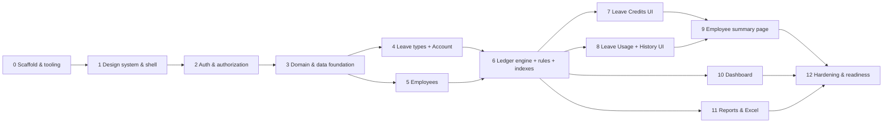

# Document 6 — Implementation Roadmap

References: architecture [SYSTEM_ARCHITECTURE.md](SYSTEM_ARCHITECTURE.md), schema [FIRESTORE_DATABASE_DESIGN.md](FIRESTORE_DATABASE_DESIGN.md), rules [FIREBASE_SECURITY_PLAN.md](FIREBASE_SECURITY_PLAN.md), UI [UI_UX_DESIGN_SPECIFICATION.md](UI_UX_DESIGN_SPECIFICATION.md), tests [BUSINESS_RULES_AND_TEST_CASES.md](BUSINESS_RULES_AND_TEST_CASES.md). Execution protocol: [SONNET_EXECUTION_HANDOFF.md](SONNET_EXECUTION_HANDOFF.md).

---

## 1. Sequencing logic

Foundational layers come first so nothing is reworked: tooling → design system and shell → authentication → domain logic and data foundation → master data (leave types, employees) → the ledger engine (the riskiest part, proven by tests **before** any ledger UI) → screens that use it → dashboard and reports → hardening.



Phases 4 and 5 are independent of each other; 7 and 8 are independent; 10 and 11 are independent. Implement them in numerical order anyway (one phase per execution session).

## 2. Global conventions (apply to every phase)

- **One phase per session.** Stop after the phase's report. Do not begin the next phase without instruction.
- **Definition of Done (every phase):** `npm run typecheck`, `npm run lint`, `npm run format:check`, `npm run test`, and `npm run build` pass; phase-specific emulator suites (`test:rules`, `test:integration`) pass; acceptance criteria met; no `any`, no `TODO` placeholders, no dead code; `IMPLEMENTATION_PROGRESS.md` updated; report delivered.
- **Naming:** components `PascalCase.tsx`; hooks `useThing.ts`; services `thing.service.ts`; domain files `camelCase.ts`; tests colocated as `*.test.ts(x)` (rules/integration tests under `tests/`).
- **Citations:** business-logic code cites rule IDs in short comments (`// BR-INS-01`).
- **Git:** `git init` in Phase 0; commit only if the user asks. Never commit `.env.local` or credentials.
- **Dependencies:** install only what the phase lists (Arch §9); record resolved versions in the Progress file.
- **Emulator only.** No phase touches a real Firebase project. Production deployment is the user's decision after Phase 12 (Q-06).
- **Report template** (end of every phase): implemented · files created/modified · dependencies added · commands run with results · test counts · deviations/unresolved issues · acceptance-criteria checklist · updated Progress.

Sizing: S ≈ half day · M ≈ 1 day · L ≈ 2+ days of focused work.

---

## Phase 0 — Project scaffold and tooling *(size M)* — **next to execute**

**Objective:** a clean, strict, lint-/test-/build-ready project with Firebase emulator wiring, and the folder skeleton from Arch §5. No product features.

**Required features**
- Vite + React 19 + TypeScript (strict) + Tailwind CSS v4 working end-to-end.
- ESLint (flat) + Prettier; Vitest (+ RTL, jsdom) for unit/component tests; a second Vitest config for emulator-based tests.
- Typed, Zod-validated environment access; Firebase app/Auth/Firestore initialization with optional emulator connection.
- Firebase emulator configuration (Auth, Firestore, UI) and a deny-all `firestore.rules`.
- Git initialized; `.gitignore` protecting secrets.

**Files and modules to create**
```
package.json  package-lock.json  index.html  vite.config.ts  vitest.config.ts  vitest.rules.config.ts
tsconfig.json  tsconfig.app.json  tsconfig.node.json  eslint.config.js  .prettierrc  .prettierignore  .editorconfig
.gitignore  .env.example  .env.development  firebase.json  .firebaserc  firestore.rules  firestore.indexes.json
src/vite-env.d.ts
src/app/main.tsx  src/app/App.tsx
src/lib/env.ts  src/lib/env.test.ts  src/lib/firebase.ts
src/styles/index.css
tests/setup/vitest.setup.ts   tests/rules/smoke.rules.test.ts
Folder skeleton with .gitkeep: src/components/{ui,layout,data,form,feedback}  src/features/{auth,dashboard,employees,leave-types,leave-credits,leave-usage,leave-history,reports,settings}
  src/services/firestore  src/domain/schemas  src/hooks  src/types  src/utils  tests/integration
```
`planning/` already exists — **do not modify or overwrite it** (except `IMPLEMENTATION_PROGRESS.md`).

**Dependencies**
- Runtime: `react`, `react-dom`, `firebase`, `zod`.
- Dev: `vite`, `@vitejs/plugin-react`, `typescript`, `@types/node`, `@types/react`, `@types/react-dom`, `tailwindcss`, `@tailwindcss/vite`, `eslint`, `@eslint/js`, `typescript-eslint`, `eslint-plugin-react-hooks`, `eslint-plugin-react-refresh`, `eslint-plugin-jsx-a11y`, `eslint-config-prettier`, `globals`, `prettier`, `prettier-plugin-tailwindcss`, `vitest`, `@vitest/coverage-v8`, `jsdom`, `@testing-library/react`, `@testing-library/user-event`, `@testing-library/jest-dom`, `@firebase/rules-unit-testing`, `firebase-tools`.
- Prior phases: none. Machine: Node ≥ 20.19 (24.x present), Java 17 present (emulator), network access for the first emulator download.

**Implementation details**
1. **Verify the directory** contains only `planning/` (plus Claude Code's own `.claude/settings.local.json`, which you leave untouched); `git init -b main`; write `.gitignore` (`node_modules`, `dist`, `coverage`, `.env.local`, `.env.*.local`, `.env.production`, `.firebase`, `*.log`, `service-account*.json`, `*.pem`, `.DS_Store`, `firebase-debug.log`, `ui-debug.log`, `firestore-debug.log`, `.claude/settings.local.json`).
2. **Scaffold Vite** (react-ts template content) without overwriting `planning/`: generate in a temporary directory and copy, or write the files by hand. Remove template demo assets (counter, logos, default CSS).
3. **`package.json`:** `"name": "hr-leave-monitor"`, `"private": true`, `"type": "module"`, `"engines": {"node": ">=20.19"}`, scripts:
   `dev` · `build` = `tsc -b && vite build` · `preview` · `typecheck` = `tsc -b` · `lint` = `eslint .` · `format` · `format:check` · `test` = `vitest run` · `test:watch` · `test:rules` = `firebase emulators:exec --only firestore --project demo-hr-leave "vitest run --config vitest.rules.config.ts"` · `emulators` = `firebase emulators:start --project demo-hr-leave` · `check` = typecheck + lint + test + build.
4. **TypeScript:** `strict`, `noUncheckedIndexedAccess`, `noImplicitOverride`, `noFallthroughCasesInSwitch`, `noUnusedLocals`, `noUnusedParameters`, `verbatimModuleSyntax`, `erasableSyntaxOnly` (if the resolved TS supports it); alias `@/*` → `src/*` in `tsconfig.app.json`, `vite.config.ts`, and both Vitest configs.
5. **Tailwind v4:** `@tailwindcss/vite` plugin; `src/styles/index.css` containing `@import "tailwindcss";` and a minimal `@theme` stub (full tokens arrive in Phase 1). The placeholder `App` uses a Tailwind class to prove it works.
6. **ESLint:** type-checked `typescript-eslint` recommended + stylistic, `react-hooks`, `react-refresh`, `jsx-a11y`; `@typescript-eslint/no-explicit-any: error`; **`no-restricted-imports`** implementing Arch §2 (`firebase/*` allowed only in `src/lib/**`, `src/services/**`, `tests/**`; `src/domain/**` may not import `react*`/`firebase*`; `src/components/**` may not import `src/services`/`src/features`). Prove it by temporarily adding a violating import, observing the lint error, and removing it.
7. **Env:** `src/lib/env.ts` parses `import.meta.env` with Zod (`VITE_FIREBASE_API_KEY`, `VITE_FIREBASE_AUTH_DOMAIN`, `VITE_FIREBASE_PROJECT_ID`, `VITE_FIREBASE_APP_ID`, `VITE_USE_FIREBASE_EMULATORS` → boolean) and exports a typed `env` or a `ConfigError` result; type the variables in `src/vite-env.d.ts`. `.env.development` holds demo values (`demo-api-key`, `demo-hr-leave.firebaseapp.com`, `demo-hr-leave`, `1:000000000000:web:demo`, `true`). `.env.example` lists names without real values.
8. **Firebase init (`src/lib/firebase.ts`):** `initializeApp`, `getAuth`, `getFirestore` (default memory cache — **no** IndexedDB persistence); when `VITE_USE_FIREBASE_EMULATORS === 'true'` call `connectAuthEmulator('http://127.0.0.1:9099', {disableWarnings: true})` and `connectFirestoreEmulator('127.0.0.1', 8080)`. Export `app`, `auth`, `db`. No credentials other than the public web config.
9. **Emulator config:** `firebase.json` (emulators: auth 9099, firestore 8080, ui 4000, `singleProjectMode: true`; `firestore.rules` and `firestore.indexes.json` paths); `.firebaserc` default project `demo-hr-leave`; `firestore.rules` = `rules_version = '2'; service cloud.firestore { match /databases/{database}/documents { match /{document=**} { allow read, write: if false; } } }`; `firestore.indexes.json` = `{"indexes": [], "fieldOverrides": []}`.
10. **Placeholder bootstrap:** `main.tsx` mounts `App` inside `StrictMode`; `App` imports the env result and renders either the "Configuration error" message (listing invalid variable names, never values) or a minimal heading "HR Leave Monitor" with a Tailwind-styled paragraph "Phase 0 scaffold". This is the only placeholder UI, replaced in Phase 1.
11. **Tests:** `env.test.ts` (valid env; each missing/invalid variable; boolean parsing). `smoke.rules.test.ts` initializes `initializeTestEnvironment({projectId: 'demo-hr-leave'})` and asserts that unauthenticated reads and writes to an arbitrary path are denied — this proves the emulator, Java, and rules wiring.
12. **Prettier:** `prettier-plugin-tailwindcss`; `.prettierrc` (single quotes, semicolons, print width 100, trailing commas `all`); format the whole repo once.
13. Update `planning/IMPLEMENTATION_PROGRESS.md` (resolved versions, commands, results).

**Acceptance criteria**
- [ ] `npm run typecheck`, `lint`, `format:check`, `test`, `build` all pass with zero warnings treated as errors.
- [ ] `npm run test:rules` starts the Firestore emulator, runs the smoke test, and passes (first run may download emulator jars).
- [ ] `npm run emulators` starts Auth, Firestore, and the UI on the planned ports; `npm run dev` serves the placeholder with no console errors and a visible Tailwind style.
- [ ] Strict TypeScript flags are on; ESLint blocks a `firebase/firestore` import from `src/features` (demonstrated, then reverted).
- [ ] Missing env variables yield the Configuration error screen (test + manual check).
- [ ] No Firebase credentials, service-account files, or real project IDs exist anywhere; `.env.local` is ignored; `git status` clean of secrets.
- [ ] Folder skeleton matches Arch §5; `planning/` unchanged except `IMPLEMENTATION_PROGRESS.md`.

**Testing requirements:** env unit tests; rules smoke test; lint-rule demonstration.
**Completion conditions:** all acceptance boxes checked; Progress updated; report delivered; **stop**. Remaining blocker to report, if any: real Firebase project ID/config (Q-06) — needed only before production use, not for Phase 0–12 development.

---

## Phase 1 — Design system and application shell *(size L)*

**Objective:** the pink/white design system, reusable components, routing skeleton, and app shell exactly per UI spec §2–§11, with placeholder pages.

**Required features:** design tokens (`@theme`), typography, shadcn/Radix primitives re-pointed to tokens, layout components, shared data/form/feedback components, router with all routes (lazy), providers (QueryClient, Toaster, ErrorBoundary), a dev-only component gallery.

**Files:** `src/styles/index.css` (tokens, base layer, focus ring, reduced-motion); `components.json`; `src/lib/cn.ts`; `src/lib/queryClient.ts`; `src/components/ui/*` (button, input, textarea, label, select, checkbox, switch, tabs, tooltip, dropdown-menu, dialog, sheet, popover, command, skeleton, sonner wrapper); `src/components/layout/{AppShell,AppSidebar,AppHeader,PageHeader,Breadcrumbs,SkipLink}.tsx`; `src/components/data/{StatCard,DataTable,Pagination,StatusBadge,LeaveBalanceCard,LeaveBreakdownTable,ProgressBar,SearchInput,FilterDropdown,YearSelect,EmployeeCombobox(shell only)}.tsx`; `src/components/form/{FormField,TextField,SelectField,DaysField,DateRangeField,FormFooter}.tsx`; `src/components/feedback/{EmptyState,LoadingState,ErrorState,ConfirmDialog,OfflineBanner}.tsx`; `src/app/{router.tsx,providers/*,ErrorBoundary.tsx}`; placeholder pages `src/features/*/…Page.tsx` (title + EmptyState "Coming in Phase N"); dev-only `src/app/dev/ComponentGallery.tsx` at `/dev/ui` (only when `import.meta.env.DEV`); `src/hooks/useDocumentTitle.ts`, `useDebouncedValue.ts`, `useSubmitGuard.ts`; component tests.

**Dependencies:** Phase 0. Install: `react-router`, `@tanstack/react-query`, `react-hook-form`, `@hookform/resolvers`, `date-fns`, `lucide-react`, `sonner`, `clsx`, `tailwind-merge`, `class-variance-authority`, `tw-animate-css`, `cmdk`, `@fontsource-variable/inter`, plus shadcn-generated `radix-ui` dependency.

**Implementation details:** tokens and contrast per UI §2 (verify the §2.3 table with a contrast tool and record results); `AppShell` per UI §5 including the mobile drawer and skip link; `StatusBadge` always renders text; `DataTable` per UI §8 (no external table library, R-05); `DaysField` enforces step 0.5 and `inputmode="decimal"`; `useSubmitGuard` ensures a single in-flight submission; router per Arch §4.2 with `lazy` routes and `RequireAuth`/`PublicOnly` **stubs that always allow** (replaced in Phase 2); the gallery shows every component in every state (including loading/empty/error/disabled/focus).

**Acceptance criteria:** every route renders inside the shell; sidebar active states correct including nested routes; drawer works below 1024 px; keyboard-only navigation and visible focus verified; the gallery shows pink used only per UI §1; contrast table verified; no raw hex outside `@theme`; Lighthouse/axe-style manual check has no critical accessibility issue on the gallery.
**Testing:** component tests for `DataTable` (sort, empty, loading, caption), `Pagination`, `FormField` (a11y wiring), `ConfirmDialog` (focus, Esc), `StatusBadge`, `YearSelect`, `useSubmitGuard`; router smoke test (all routes resolve).
**Completion:** DoD + a screenshot-free written visual verification list in the report.

---

## Phase 2 — Authentication and authorization *(size L)*

**Objective:** real sign-in/out, session persistence, profile authorization, route guards, password reset, and the first Security Rules (users + deny-all) with tests.

**Required features:** FR-AUTH-01…09, 11, 12.

**Files:** `src/services/auth.service.ts`, `src/services/users.service.ts`; `src/features/auth/{AuthProvider.tsx,useAuth.ts,LoginPage.tsx,ForgotPasswordPage.tsx,AccessDeniedPage.tsx,authErrors.ts,schemas}`; `src/app/guards/{RequireAuth,PublicOnly}.tsx` (replace stubs); header/sidebar user menu and logout wired to real data; `src/domain/schemas/auth.ts`; `firestore.rules` (helpers + `users` + final deny); `tests/rules/users.rules.test.ts`; `tests/setup/emulator.ts` (test-environment helpers, fixture users); `scripts/seed-emulator.mjs` (creates one HR user in the Auth emulator and its `users/{uid}` doc via emulator REST endpoints; **refuses to run unless the emulator host env vars point to localhost**) and an npm script `seed:emulator`.

**Dependencies:** Phases 0–1.

**Implementation details:** auth state machine per Security §4.2; `onAuthStateChanged` subscription once; profile read via `getDoc` once per sign-in; `queryClient.clear()` on sign-out; global `permission-denied` → `refreshProfile` via QueryCache/MutationCache `onError`; error mapping table Security §4.4; reset response is always generic; no registration route or text; rules exactly per Security §5/§6.1 (helpers + `users`) — all other collections remain denied.

**Acceptance criteria:** TC-AUTH-01…12 pass; unauthenticated URL → `/login`; refresh keeps session; inactive/no-profile/wrong-role → Access Denied; logout clears caches; `npm run seed:emulator` + `npm run emulators` + `npm run dev` allow a manual sign-in.
**Testing:** TC-AUTH-* (C, with `auth.service` mocked, plus one emulator-backed integration test of sign-in), TC-RULES-USR-01…06.
**Completion:** DoD; report includes the V-3 verification result (diff/affectedKeys) and any rules-language findings.

---

## Phase 3 — Domain logic and data foundation *(size L)*

**Objective:** all pure business logic, validation schemas, types, converters, and service plumbing, fully unit-tested, before any data screen exists.

**Files:** `src/domain/constants.ts` (README §4 table), `errors.ts` (`AppError`, codes), `days.ts` (`isValidDays`, `formatDays`, `addDays` exact), `dates.ts` (`isIsoDate`, `isRealDate`, `inclusiveDays`, `isInYear`, `overlaps`, `findOverlaps`, `todayIso`), `balance.ts` (`calcAvailable`, `applyEntryToBalance` → throws `INSUFFICIENT_BALANCE`), `ledger.ts` (`buildAllocationEntry`, `buildUsageEntry`, `buildReversalEntry`, `entryEffect`, `makeBalanceId`, `makeReversalId`), `summary.ts` (`summarizeBalances`, `lowBalances`), `reconcile.ts`, `schemas/{employee,leaveType,allocation,usage,reversal,reportFilters,auth}.ts`; `src/types/{firestore.ts,models.ts,index.ts}` per DB §4; `src/services/firestore/{paths.ts,converters.ts,errors.ts}` (collection constants, `FirestoreDataConverter`s, `mapFirebaseError`); `src/lib/queryClient.ts` finalization (global handlers); unit tests beside each file.

**Dependencies:** Phases 0–2 (no new packages).

**Implementation details:** functions are pure and total; money-like exactness via the 0.5-step rule; `applyEntryToBalance` is the single implementation of balance arithmetic and mirrors the rules (sign matrix DB §3.6); `findOverlaps` ignores reversed entries; `reconcile(ledger, balances)` implements DB §5.3; Zod messages equal UI §12 verbatim; converters map `Timestamp ↔ Date` and add `id`; `mapFirebaseError` per Arch §8.3.

**Acceptance criteria:** unit coverage ≥ 95 % statements for `src/domain`; the Juan-2026 dataset yields 18/5/13; all BR-FR, BR-INS, BR-LU-03…05, BR-COR rules have at least one test; no Firebase or React import in `src/domain` (lint passes).
**Testing:** TC-SUM-01, TC-CR-04/05, TC-LU-05…10, TC-LU-16, TC-REV-11, TC-RPT-08 (reconcile unit), schema tests for every form message.
**Completion:** DoD; report lists the public domain API.

---

## Phase 4 — Leave types and account settings *(size M)*

**Objective:** configurable leave types (FR-LT-*) and account settings (FR-AUTH-10).

**Files:** `src/services/leaveTypes.service.ts`; `src/features/leave-types/{LeaveTypesSettingsPage,LeaveTypeFormDialog,hooks/*}`; `src/features/settings/{SettingsLayout,AccountSettingsPage}.tsx`; `src/features/auth` additions for `changePassword`/`updateOwnName`; `firestore.rules` + `leaveTypes` block (Security §6.1); `tests/rules/leaveTypes.rules.test.ts`; integration tests.

**Dependencies:** Phase 3.

**Implementation details:** list/create/update/toggle; client-side case-insensitive name uniqueness; starter-types batch; ConfirmDialog for deactivate; account forms per UI §6.14 with re-authentication for password change; caches and invalidation per Arch §6.4.

**Acceptance criteria:** TC-LT-01…08, TC-AUTH-10 pass; deactivated types vanish from pickers (picker components exist from Phase 1/5 usage) but remain in lists; UI matches §6.13/§6.14.
**Testing:** TC-LT-*, TC-RULES-LT-01…05, TC-AUTH-10.
**Completion:** DoD.

---

## Phase 5 — Employees *(size L)*

**Objective:** employee directory, add/edit/archive/restore, uniqueness reservation, and the employee picker.

**Files:** `src/services/employees.service.ts`; `src/features/employees/{EmployeesPage,EmployeeFormDialog,EmployeeActionsMenu,hooks/*}`; `src/components/data/EmployeeCombobox.tsx` (complete); `firestore.rules` + `employees` and `employeeNumbers` blocks; `tests/rules/employees.rules.test.ts`; `tests/integration/employees.test.ts`.

**Dependencies:** Phase 3.

**Implementation details:** transactions per DB §6.5 (create with reservation; ID swap; archive/restore); client-side search/filter/sort/pagination over the cached list; URL-bound filters; ConfirmDialog for archive; combobox lists only non-archived employees by default.

**Acceptance criteria:** TC-EMP-01…16 pass; duplicate IDs in any case are rejected without partial writes; no delete UI/API; archived employees hidden by default and excluded from the picker.
**Testing:** TC-EMP-*, TC-RULES-EMP-01…10.
**Completion:** DoD.

---

## Phase 6 — Ledger engine, rules, and indexes *(size L — highest risk)*

**Objective:** the atomic allocation / usage / reversal operations, the ledger and balance rules, indexes, and proof that the design holds, **with no ledger UI yet**.

**Files:** `src/services/leaveLedger.service.ts` (`recordAllocation`, `recordUsage`, `reverseEntry`, `listLedgerPage`, `getLedgerYear`, `findUsageForOverlap`), `src/services/leaveBalances.service.ts` (`getBalancesForEmployeeYear`, `getBalancesForEmployees`, `getYearBalances`, `getYearAggregate`, `getTypeAggregate`, `getLowBalances`); `firestore.rules` + balances and ledger blocks (Security §6.1); `firestore.indexes.json` (DB §9, all 11); `tests/rules/ledger.rules.test.ts`, `tests/rules/rulesConstructs.test.ts` (V-1…V-10), `tests/integration/{allocation,usage,reversal,concurrency,idempotency}.test.ts`; script `test:integration` (`firebase emulators:exec --only auth,firestore …`).

**Dependencies:** Phases 4, 5.

**Implementation details:** **First task:** write `rulesConstructs.test.ts` and measure the access-call counts (V-8) for allocation, usage, and reversal commits; if any limit is exceeded apply the fallback ladder in Security §6.6 and record it in the Deviation Log (the user must approve any change that weakens a binding). Flows exactly per DB §6; all reads before writes; idempotency pre-read; deterministic `rev_` IDs; every service function returns a typed result (`{status: 'created'|'duplicate', …}`) or throws `AppError`; no function ever writes a ledger entry or balance outside a transaction.

**Acceptance criteria:** all of TC-CR-01…03/06…08/11/12/14, TC-LU-01…04/11…13/19/20, TC-DUP-01/02/05/06, TC-REV-01…07/12/14, TC-CONC-01…04, and **every TC-RULES-LED row** pass; V-1…V-10 each pass or are logged as deviations; reconcile passes after every integration test; measured access-call counts recorded in the Progress file.
**Stop condition:** if V-4 or V-5 (core `getAfter`/`exists` semantics) fail, **stop and report** — do not redesign silently.
**Completion:** DoD + the rules-test matrix attached to the report.

---

## Phase 7 — Leave Credits UI *(size M)*

**Objective:** FR-CR-01…08 screens.

**Files:** `src/features/leave-credits/{LeaveCreditsPage,BalancesTable,AllocationHistory,AllocationDialog,hooks/*}`; `src/features/leave-history/ReverseDialog.tsx` (shared; first built here); hooks wrapping the Phase 6 services.

**Dependencies:** Phase 6.

**Implementation details:** UI §6.7/§6.8; idempotency key generated when the dialog opens; preview strip reads the current balance; invalidation per Arch §6.4; allocation history uses `transactionType == ALLOCATION`; reverse flow from the history rows.

**Acceptance criteria:** TC-CR-09, 10, 13; allocating 10 then 2 shows 12 with two history rows; archived employees and inactive types cannot be chosen; success/error states per UI §11–§12.
**Testing:** component tests for AllocationDialog (validation, preview, pending, duplicate protection), BalancesTable (expand, empty), ReverseDialog (blocked case); TC-DUP-03/04.
**Completion:** DoD.

---

## Phase 8 — Leave Usage and Leave History UI *(size L)*

**Objective:** FR-LU-01…11.

**Files:** `src/features/leave-usage/{LeaveUsagePage,RecordUsageDialog,OverlapWarning,hooks/*}`; `src/features/leave-history/{LeaveHistoryPage,LedgerTable,LedgerDetailSheet,hooks/*}`; the reverse-and-re-enter flow with the persistent banner (RK-07).

**Dependencies:** Phase 6 (and the ReverseDialog from Phase 7).

**Implementation details:** UI §6.9–§6.11; native date inputs bounded to the chosen year; balance strip and insufficient-balance handling; overlap check via `findUsageForOverlap` + `findOverlaps`; server filters and cursor pagination with "Load more"; client-side text/date filters with the "Load all" notice; detail sheet shows snapshots and links.

**Acceptance criteria:** TC-LU-14…18, TC-REV-08…10/13, TC-DUP-03/04, TC-UX-01 for these pages; recording, reversing, and re-entering work end-to-end against the emulator; insufficient balance blocked at all layers.
**Testing:** component tests (RecordUsageDialog states, OverlapWarning, LedgerTable filters/empty/error, reverse flows); a scripted manual walkthrough recorded in the report.
**Completion:** DoD.

---

## Phase 9 — Employee leave summary page *(size M)*

**Objective:** FR-SUM-01…06.

**Files:** `src/features/employees/{EmployeeDetailPage,EmployeeHeaderBlock,EmployeeHistory,hooks/*}`; wiring of Export/Allocate/Record shortcuts.

**Dependencies:** Phases 7, 8.

**Implementation details:** UI §6.6; `summarizeBalances` for the tiles and breakdown; zero rows for active types lacking a balance; history query per DB §8.6; year selector bound to `?year=`; archived-employee banner and disabled actions.

**Acceptance criteria:** TC-SUM-02…08 pass; for Juan-2026 the page shows exactly 18/5/13 and the per-type rows; changing the year changes all figures.
**Testing:** TC-SUM-*; component tests with fixture balances/ledger.
**Completion:** DoD.

---

## Phase 10 — Dashboard *(size M)*

**Objective:** FR-DASH-01…08.

**Files:** `src/features/dashboard/{DashboardPage,widgets/{StatCards,UsageByType,LowBalances,RecentTransactions,RecentAllocations,BalanceOverview},hooks/*}`.

**Dependencies:** Phase 6.

**Implementation details:** queries per DB §8.7 (aggregations; per-type aggregations; indexed low-balance query); independent per-widget loading/error states; year caption; if an aggregation index is missing in production the fallback is documented in DB §8.7 (do not implement the fallback unless needed; log it).

**Acceptance criteria:** TC-DASH-01…08; figures equal the Employee page and the Excel export for the same year.
**Testing:** TC-DASH-*; integration test of the aggregation helpers on the emulator.
**Completion:** DoD.

---

## Phase 11 — Reports and Excel export *(size L)*

**Objective:** FR-RPT-01…07.

**Files:** `src/services/reports.service.ts`; `src/utils/excel/{buildWorkbook.ts,sheets/*.ts,formats.ts,fileName.ts}`; `src/features/reports/{ReportsPage,ReportFilters,ReportPreview,hooks/useExportReport.ts}`; export shortcut on the Employee page.

**Dependencies:** Phase 6. Install SheetJS CE from the CDN tarball (pin the exact URL; confirm the current version at install; commit the lockfile entry).

**Implementation details:** workbook exactly per UI §14; builder is pure (data in → workbook out) and unit-tested by reading the generated buffer back; dynamic `import('xlsx')` only inside the export action; reconciliation before download; progress state for year loads.

**Acceptance criteria:** TC-RPT-01…14; the workbook for Juan-2026 shows Summary 18/5/13 and matching Breakdown/Transactions; `xlsx` absent from the initial bundle (verify with the build output); remark `=1+1` remains text.
**Testing:** TC-RPT-* (U mostly), plus a manual open in Excel/LibreOffice if available (otherwise report as not verified).
**Completion:** DoD.

---

## Phase 12 — Hardening and readiness *(size M)*

**Objective:** close quality gaps and produce the deployment-readiness checklist. **No deployment.**

**Required work:** full accessibility pass (UI §15 checklist, keyboard walkthrough, 200 % zoom, 320 px); responsive pass (UI §13); error/empty/loading audit (TC-UX-01); reconcile-on-demand utility (Settings footer or a dev script) if time permits; `npm audit` review; bundle analysis (confirm lazy chunks and SheetJS isolation); finalize `firestore.indexes.json`; documentation: `README.md` (setup, scripts, emulator workflow, provisioning steps from Security §2.1), `docs`-style notes only if useful; optional Playwright smoke test (login → add employee → allocate → record → report) **only if the user approves adding `@playwright/test`**; Hosting config (SPA rewrite, security headers per Security §10) written but not deployed.

**Readiness checklist to deliver (for the user to execute):** create the Firebase project (Q-06); enable Email/Password; disable sign-up; create the HR user + `users` profile; deploy rules and indexes; run a **production smoke test** to catch missing composite indexes (RK-04); set API key referrer restrictions; consider App Check; decide on Blaze for scheduled backups (RK-05); deploy Hosting.

**Acceptance criteria:** all suites green (`check`, `test:rules`, `test:integration`); no critical accessibility findings; Progress file complete; checklist delivered; every requirement in SYSTEM_REQUIREMENTS §10 traced to a passing test or a documented manual check.
**Completion:** final report to the user summarizing the system, test totals, known limitations (Requirements §9), and open questions.

---

## 3. Phase ↔ requirement ↔ test coverage

| Phase | Requirements | Primary tests |
|---|---|---|
| 0 | NFR-SEC-02, NFR-MNT-01, NFR-TEST-01 | env tests, rules smoke |
| 1 | FR-UX-01…04, NFR-RSP, NFR-A11Y | component tests, TC-UX/A11Y |
| 2 | FR-AUTH-01…09, 11, 12 | TC-AUTH-*, TC-RULES-USR-* |
| 3 | BR-CALC, BR-FR, BR-INS, BR-COR logic | domain unit tests |
| 4 | FR-LT-*, FR-AUTH-10 | TC-LT-*, TC-RULES-LT-* |
| 5 | FR-EMP-* | TC-EMP-*, TC-RULES-EMP-* |
| 6 | FR-CR-02/03, FR-LU-03/06/07/10/11, NFR-REL | TC-RULES-LED-*, TC-CONC-*, TC-DUP-*, TC-REV-* |
| 7 | FR-CR-01/04…09 | TC-CR-*, UI tests |
| 8 | FR-LU-01/02/04/05/08/09 | TC-LU-*, TC-REV-* |
| 9 | FR-SUM-* | TC-SUM-* |
| 10 | FR-DASH-* | TC-DASH-* |
| 11 | FR-RPT-* | TC-RPT-* |
| 12 | NFR-* sweep | TC-A11Y/UX, audits |
