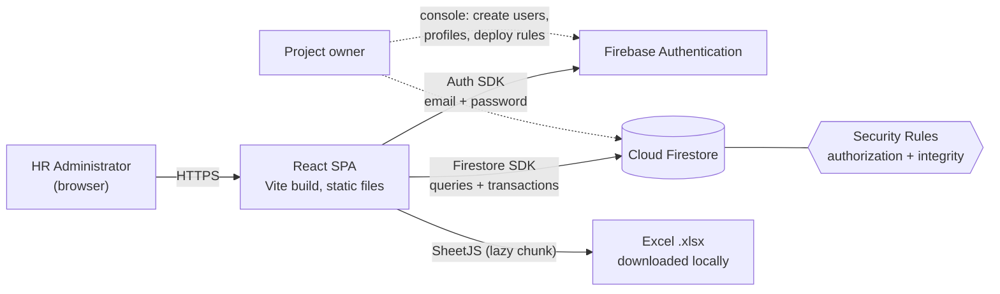
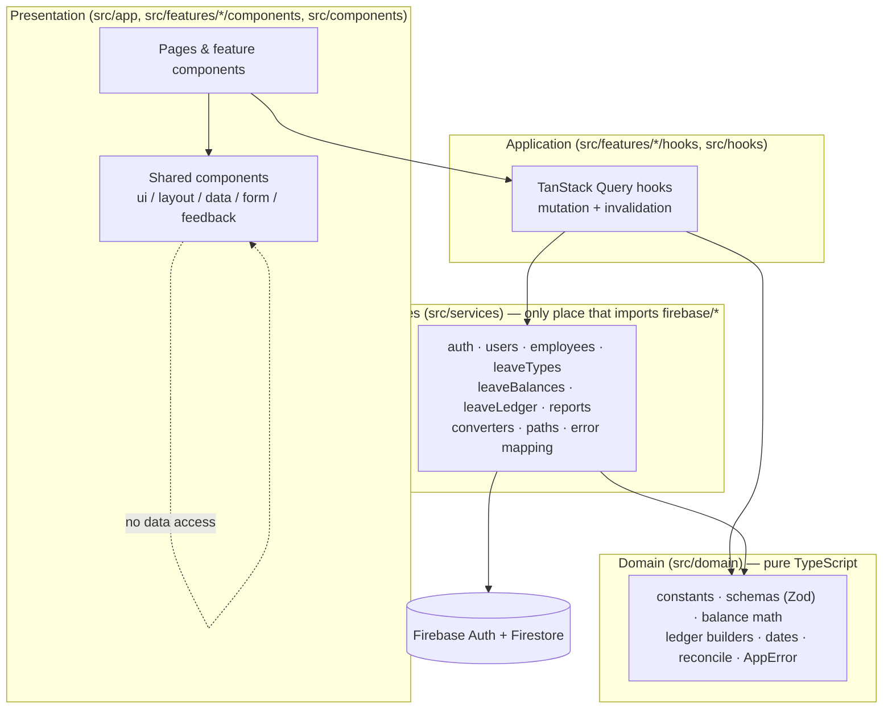
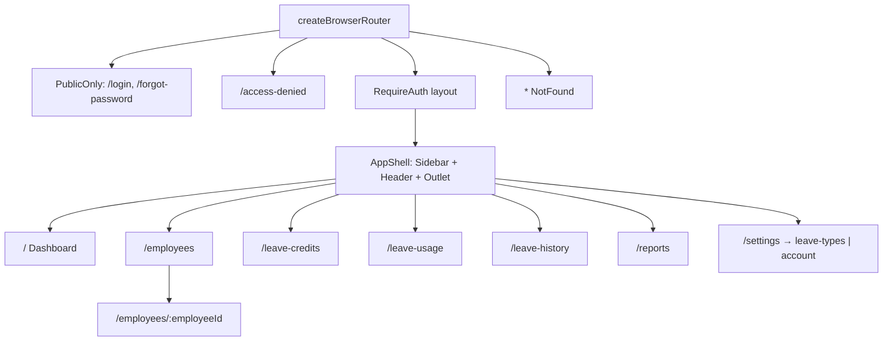
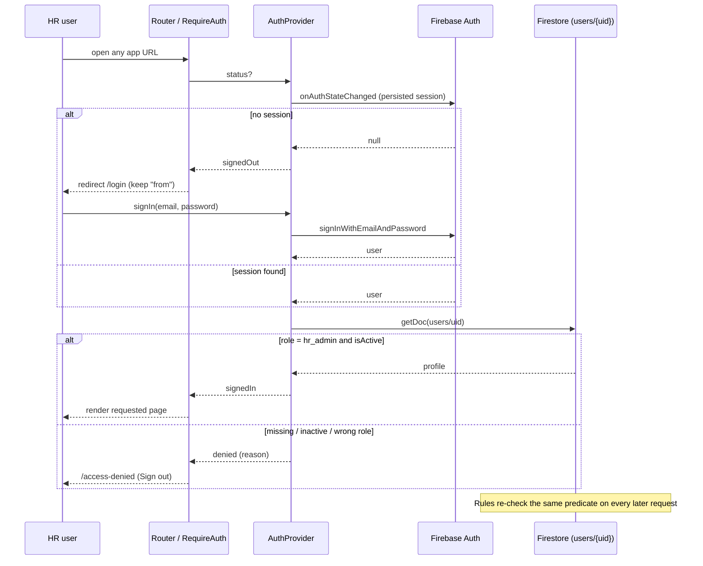
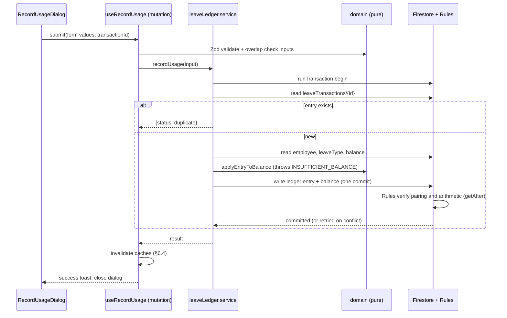
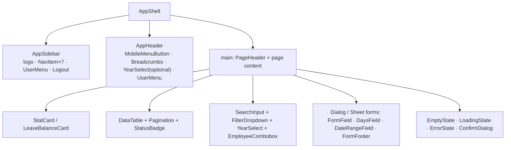

# Document 2 — System Architecture

Constants and decision IDs: [README.md](README.md). Data shapes: [FIRESTORE_DATABASE_DESIGN.md](FIRESTORE_DATABASE_DESIGN.md). Security: [FIREBASE_SECURITY_PLAN.md](FIREBASE_SECURITY_PLAN.md).

---

## 1. Overview and system context

A single-page application (SPA) talks directly to Firebase Authentication and Cloud Firestore through the official modular JavaScript SDK. There is no custom server **[D-01]**. Excel files are generated in the browser **[D-10]**.



## 2. Architectural principles

1. **Layered, one-way dependencies.** UI → hooks → services → Firebase. Business rules are pure functions in `src/domain` with no React and no Firebase imports.
2. **Rules are the boundary.** The UI never needs to be trusted; the client's transaction code is a convenience that mirrors rules.
3. **Server state ≠ UI state.** TanStack Query owns server data; React state owns ephemeral UI; the URL owns filters and the year.
4. **One implementation of each calculation.** Totals, availability, overlap, inclusive days, and reconciliation each exist exactly once in `src/domain`.
5. **Smallest thing that works.** No global store, no real-time listeners, no custom server, no chart/table libraries (R-05).
6. **Everything typed.** TypeScript strict; Zod schemas are the single source of runtime validation and infer the input types.



Import rules (enforced with ESLint `no-restricted-imports`, configured in Phase 0):

| Layer | May import | May **not** import |
|---|---|---|
| `src/domain` | `zod`, `date-fns`, `src/types` | `react*`, `firebase*`, `src/services`, anything UI |
| `src/services` | `firebase/*`, `src/domain`, `src/lib`, `src/types` | `react*`, `src/features`, `src/components` |
| `src/features/*`, `src/hooks` | `src/services`, `src/domain`, `src/components`, `src/hooks`, `src/types`, `src/utils` | `firebase/*` directly; another feature's non-public files |
| `src/components/*` | `src/lib/cn`, `src/utils`, `src/types`, libraries | `src/services`, `src/features`, `firebase/*` |

## 3. Backend decision — direct Firebase vs a server **[D-01]**

| Option | Integrity | Security surface | Cost / ops | Verdict |
|---|---|---|---|---|
| **A. Client-only Firebase** (Auth + Firestore + Rules) | Transactions + rules verifying arithmetic and links | Public API key; Rules are the only gate | Free (Spark); nothing to host or patch | **Chosen** |
| B. Express + Firebase Admin SDK | Server-side logic, easy to audit | Admin credentials to protect; a server to host and secure | Hosting cost, ops, uptime | Rejected: unnecessary for one trusted role |
| C. Cloud Functions callables for writes | Strongest; atomic multi-step corrections | Smaller (rules can deny all client writes) | Requires Blaze plan; cold starts; two codebases | Documented upgrade path |

**Operations that would benefit from trusted server-side code** (none is MVP-blocking): atomic "reverse and re-record"; user creation/disabling UI; scheduled backups/exports; server-validated report generation; audit alerts; rate limiting; enforcing `days ≤ inclusive date range`. Trade-offs are detailed in Security §9.

## 4. Frontend architecture

### 4.1 Application shell and providers

```
<StrictMode>
  <ConfigGate>                    // env validation result; shows Configuration error screen
    <QueryClientProvider>         // TanStack Query, global onError (permission-denied → refreshProfile)
      <AuthProvider>              // auth state machine (Security §4.2)
        <RouterProvider />        // createBrowserRouter
        <Toaster />               // sonner
```
`ErrorBoundary` wraps the router and each route element (`errorElement`). There is no other global state.

### 4.2 Routes (canonical)

| Path | Component | Guard |
|---|---|---|
| `/login` | `LoginPage` | PublicOnly |
| `/forgot-password` | `ForgotPasswordPage` | PublicOnly |
| `/access-denied` | `AccessDeniedPage` | signed in (any status except loading) |
| `/` | `DashboardPage` | RequireAuth → `AppShell` |
| `/employees` | `EmployeesPage` (add/edit dialogs) | RequireAuth |
| `/employees/:employeeId` | `EmployeeDetailPage` | RequireAuth |
| `/leave-credits` | `LeaveCreditsPage` | RequireAuth |
| `/leave-usage` | `LeaveUsagePage` | RequireAuth |
| `/leave-history` | `LeaveHistoryPage` | RequireAuth |
| `/reports` | `ReportsPage` | RequireAuth |
| `/settings` | redirect → `/settings/leave-types` | RequireAuth |
| `/settings/leave-types` | `LeaveTypesSettingsPage` | RequireAuth |
| `/settings/account` | `AccountSettingsPage` | RequireAuth |
| `*` | `NotFoundPage` | — |

Route modules are lazy-loaded (`lazy()`), so each page is a separate chunk.



### 4.3 URL as state

| Page | Search params |
|---|---|
| Year-aware pages (Dashboard, Credits, Usage, History, Reports, Employee Detail) | `?year=2026` (default: current year; validated against the allowed range) |
| Employees | `?q=&status=&archived=active\|archived\|all&page=&size=` |
| Leave History / Usage | `?employee=&type=&kind=&from=&to=&q=` |

Pages are therefore bookmarkable and shareable; browser Back restores filters.

### 4.4 Forms

React Hook Form with the Zod resolver; schemas live in `src/domain/schemas` and are shared by forms, services (re-validate before writing), and tests. Field-level errors render under the control; server/transaction errors map to `AppError` codes and render in the form footer or as a toast (UI §12). A form's submit handler is wrapped by `useSubmitGuard` (single in-flight submission, disables the button).

## 5. Project structure **[D-12]**

```
hr-management/
├─ planning/                         (these documents)
├─ public/                           favicon, static assets
├─ src/
│  ├─ app/                           main.tsx, App.tsx, router.tsx, providers/, guards/, error-boundary
│  ├─ components/
│  │  ├─ ui/                         shadcn-generated primitives (button, input, dialog, sheet, select, tabs, ...)
│  │  ├─ layout/                     AppShell, AppSidebar, AppHeader, PageHeader, Breadcrumbs
│  │  ├─ data/                       DataTable, Pagination, StatCard, StatusBadge, LeaveBalanceCard,
│  │  │                              LeaveBreakdownTable, YearSelect, SearchInput, FilterDropdown, EmployeeCombobox
│  │  ├─ form/                       FormField, TextField, SelectField, DaysField, DateRangeField, FormFooter
│  │  └─ feedback/                   EmptyState, LoadingState, ErrorState, ConfirmDialog, Skeletons
│  ├─ features/
│  │  ├─ auth/                       AuthProvider, useAuth, LoginPage, ForgotPasswordPage, AccessDeniedPage
│  │  ├─ dashboard/                  DashboardPage, widgets/, hooks/
│  │  ├─ employees/                  EmployeesPage, EmployeeDetailPage, EmployeeFormDialog, hooks/
│  │  ├─ leave-types/                LeaveTypesSettingsPage, LeaveTypeFormDialog, hooks/
│  │  ├─ leave-credits/              LeaveCreditsPage, AllocationDialog, AllocationHistory, hooks/
│  │  ├─ leave-usage/                LeaveUsagePage, RecordUsageDialog, OverlapWarning, hooks/
│  │  ├─ leave-history/              LeaveHistoryPage, LedgerTable, ReverseDialog, hooks/
│  │  ├─ reports/                    ReportsPage, ReportFilters, hooks/useExportReport
│  │  └─ settings/                   SettingsLayout, AccountSettingsPage
│  ├─ services/
│  │  ├─ firestore/                  paths.ts, converters.ts, errors.ts (mapFirebaseError)
│  │  ├─ auth.service.ts  users.service.ts  employees.service.ts  leaveTypes.service.ts
│  │  ├─ leaveBalances.service.ts  leaveLedger.service.ts  reports.service.ts
│  ├─ domain/
│  │  ├─ constants.ts  errors.ts  dates.ts  days.ts  balance.ts  ledger.ts  reconcile.ts  summary.ts
│  │  └─ schemas/                    auth, employee, leaveType, allocation, usage, reversal, reportFilters
│  ├─ lib/                           firebase.ts (init + emulators), env.ts (Zod), queryClient.ts, cn.ts
│  ├─ hooks/                         useSubmitGuard, useYearParam, useDebouncedValue, useDocumentTitle
│  ├─ types/                         firestore.ts (Doc shapes), models.ts (domain), index.ts
│  ├─ utils/                         format.ts (dates, numbers, names), excel/ (workbook builders)
│  └─ styles/                        index.css (Tailwind import, @theme tokens, base layer)
├─ scripts/                          seed-emulator.mjs (emulator-only dev seed; refuses non-localhost hosts)
├─ tests/
│  ├─ rules/                         Security Rules tests (emulator)
│  ├─ integration/                   service tests against the emulator
│  └─ setup/                         vitest setup, emulator helpers, fixtures
├─ firestore.rules  firestore.indexes.json  firebase.json  .firebaserc
├─ .env.example  .env.development  .gitignore
├─ vite.config.ts  vitest.config.ts  vitest.rules.config.ts
├─ tsconfig.json  tsconfig.app.json  tsconfig.node.json
├─ eslint.config.js  .prettierrc  components.json  package.json  index.html
```

Feature folders export a small public API from `index.ts`; other features import only from that.

## 6. State and data fetching

### 6.1 Principles

TanStack Query is the only server-state cache **[D-09]**. No Redux/Zustand. No real-time listeners (the Auth observer is the single exception). Staleness is controlled by `staleTime`; users can refresh with an explicit button. Because a single HR admin makes nearly all changes, mutation-driven invalidation keeps views correct without listeners (multi-device edits appear after `staleTime` or Refresh).

### 6.2 Query keys

| Key | Data | `staleTime` |
|---|---|---|
| `['profile', uid]` | user profile (via AuthProvider) | session |
| `['employees']` | all employees | 5 min |
| `['leaveTypes']` | all leave types | 5 min |
| `['balances','employee', employeeId, year]` | one employee-year | 60 s |
| `['balances','page', year, idsKey]` | Credits matrix / dashboard overview | 60 s |
| `['ledger', {year, employeeId, leaveTypeId, kind}]` | `useInfiniteQuery`, pages of 25 | 30 s |
| `['dashboard', year, ...widget]` | aggregates and small lists | 60 s |
| `['report-data', filters]` | year-wide reads | `gcTime: 0`, never cached |

### 6.3 Caching and fetch rules

Employees and leave types are loaded once and reused by every picker/table; they are never refetched on navigation within `staleTime`. Ledger lists are server-filtered and paginated; **the whole ledger is never loaded for a table view**. Year-wide reads happen only on report generation (and on "Load all" for client-side text/date filters).

### 6.4 Invalidation map

| Mutation | Invalidates |
|---|---|
| Create/edit/archive/restore employee | `['employees']`; `['dashboard', *]`; `['balances','page', *]` (names shown) |
| Create/edit/toggle leave type | `['leaveTypes']`; `['dashboard', year, 'byType']` |
| Allocation / usage / reversal for (employee E, year Y) | `['balances','employee',E,Y]`; `['balances','page',Y,*]`; `['ledger',*]` for Y; `['dashboard',Y,*]` |
| Edit own name | `['profile']` |
| Sign out | `queryClient.clear()` |

## 7. Authentication flow



## 8. Data flow and service boundaries

### 8.1 Read path

`Page → hook (useQuery) → service function → Firestore SDK → converter → domain model → hook → component`. Components receive plain domain objects (`Date`, numbers), never `Timestamp`/`DocumentSnapshot`.

### 8.2 Write path (leave usage example)



### 8.3 Error handling

Services throw `AppError { code: AppErrorCode, message, details? }` (codes in DB §4). `mapFirebaseError` converts SDK errors: `permission-denied` → `PERMISSION_DENIED`; `unavailable`/`failed-precondition` offline → `OFFLINE`; `aborted` after retries → `CONTENTION`; `already-exists` → `duplicate` handling; unknown → `UNKNOWN`. Hooks surface errors to the UI; forms show `VALIDATION` / `INSUFFICIENT_BALANCE` inline and other codes as toasts. A global handler treats `PERMISSION_DENIED` as a possible session/authorization change (Security §4.3). Logging records `code` and operation name only — no names, remarks, or emails.

### 8.4 Excel export path

`ReportsPage → useExportReport → reports.service.loadReportData(filters) → domain.reconcile + summarize → utils/excel/buildWorkbook → dynamic import('xlsx') → writeFile`. SheetJS is a lazy chunk that never loads outside Reports (NFR-PERF-04). See UI §14 for the workbook specification.

## 9. Recommended dependencies **[D-11]**

*Install each dependency in the phase that first needs it* (Phase 0 installs tooling, `firebase`, and `zod` only). Majors below are targets; record the resolved versions in IMPLEMENTATION_PROGRESS.md and log any API differences as deviations **[RK-08]**.

### Runtime

| Package | Purpose | Phase |
|---|---|---|
| `react`, `react-dom` (19) | UI | 0 |
| `firebase` (modular SDK, v11+/12) | Auth + Firestore | 0 |
| `zod` | Env validation (Phase 0), then all form/domain schemas | 0 |
| `react-router` (7; `createBrowserRouter`) | Client-side routing (if `react-router-dom` is required by the resolved major, use it and log it) | 1 |
| `@tanstack/react-query` (5) | Server-state cache | 1 |
| `react-hook-form`, `@hookform/resolvers` | Forms + Zod integration | 1 |
| `date-fns` | Date formatting/arithmetic (`format`, `parseISO`, `differenceInCalendarDays`, `isValid`) | 1 |
| `lucide-react` | Icons | 1 |
| `sonner` | Toasts | 1 |
| `clsx`, `tailwind-merge`, `class-variance-authority`, `tw-animate-css` | Styling utilities used by shadcn components | 1 |
| shadcn/ui CLI → `radix-ui` (Dialog, Select, Tabs, Popover, DropdownMenu, Tooltip, Checkbox, Switch…) | Accessible primitives copied into `src/components/ui` | 1 |
| `cmdk` | Searchable combobox (employee picker) | 1 (used in 5/7) |
| `@fontsource-variable/inter` | Self-hosted Inter (no external font request) | 1 |
| `xlsx` (SheetJS CE) from `https://cdn.sheetjs.com/xlsx-<version>/xlsx-<version>.tgz` — **not** the stale npm `xlsx` | Excel generation. Pin the exact tarball URL; commit the lockfile with its integrity hash (RK-06). Planning-time check found 0.20.3 reported as current; verify at install | 11 |

### Development

| Package | Purpose |
|---|---|
| `vite`, `@vitejs/plugin-react`, `typescript`, `@types/node`, `@types/react`, `@types/react-dom` | Build, types |
| `tailwindcss`, `@tailwindcss/vite` | Tailwind v4 (CSS-first config) |
| `eslint`, `@eslint/js`, `typescript-eslint`, `eslint-plugin-react-hooks`, `eslint-plugin-react-refresh`, `eslint-plugin-jsx-a11y`, `eslint-config-prettier`, `globals` | Linting (flat config) |
| `prettier`, `prettier-plugin-tailwindcss` | Formatting |
| `vitest`, `@vitest/coverage-v8`, `jsdom`, `@testing-library/react`, `@testing-library/user-event`, `@testing-library/jest-dom` | Unit/component tests |
| `@firebase/rules-unit-testing`, `firebase-tools` | Rules and integration tests against emulators (`npx firebase`; Java 17 present) |
| `@playwright/test` *(optional, Phase 12)* | One smoke flow |

Not adopted: Redux/Zustand, Axios, TanStack Table, any chart library, moment, MUI/Ant, Formik, a CSS-in-JS library.

**Version check at Phase 0:** Node 24 satisfies Vite's engine requirement; set `"engines": {"node": ">=20.19"}`. If a resolved major differs from the targets (e.g., Zod 4 with `@hookform/resolvers`), follow that package's current documentation and log it.

## 10. Component architecture



The full component inventory with props and behaviour is in UI §7. Components are presentational and data-agnostic; each feature composes them with its own hooks.

## 11. Configuration and tooling summary (Phase 0 detail in Roadmap)

- `tsconfig`: `strict`, `noUncheckedIndexedAccess`, `noImplicitOverride`, `noFallthroughCasesInSwitch`, `noUnusedLocals`, `noUnusedParameters`, `verbatimModuleSyntax`; path alias `@/* → src/*` mirrored in Vite and Vitest.
- ESLint: type-checked `typescript-eslint` rules, `no-explicit-any: error`, `no-restricted-imports` implementing §2, jsx-a11y.
- Scripts: `dev`, `build` (`tsc -b && vite build`), `preview`, `typecheck`, `lint`, `format`, `format:check`, `test`, `test:watch`, `test:rules`, `emulators`, `check` (typecheck + lint + test + build).
- Emulators: Auth 9099, Firestore 8080, UI 4000; project `demo-hr-leave`.
- The app connects to emulators only when `VITE_USE_FIREBASE_EMULATORS === 'true'`; it never enables IndexedDB persistence (A-06).

## 12. Architectural decisions and justifications

| ID | Decision | Justification | Rejected alternative |
|---|---|---|---|
| D-01 | Client-only Firebase | One trusted role; strict rules; free tier | Express / Cloud Functions (§3) |
| D-02 | `users` doc authorization | Console-manageable; immediate deactivation | Custom claims (need Admin SDK; delayed revocation) |
| D-03 | Ledger + materialized balances, rule-bound | Auditable history and O(1) reads; integrity enforced even against a modified client | Compute-on-read (expensive, no rule-enforced totals); balances only (no history) |
| D-04/R-02 | Reversal entries with deterministic IDs | Immutable audit trail; duplicate-proof | In-place edits with history subcollection (rule-heavy, mutable) |
| D-09 | TanStack Query, no global store | Caching, dedupe, pagination, invalidation built in | Redux/Zustand (more code, same problems) |
| D-10 | SheetJS CE, one workbook | Client-side, small, standard | ExcelJS (heavier; styling) — fallback |
| D-11 | Tailwind v4 + shadcn/Radix | Fast, accessible primitives owned in-repo | MUI/Ant (heavy, harder to theme pink/white) |
| AD-01 | URL as state for year and filters | Shareable, restores on Back | Context/local state |
| AD-02 | Route-level code splitting | Smaller initial bundle | Single bundle |
| AD-03 | Memory cache only (no Firestore offline persistence) | Transactions need connectivity; avoids stale multi-tab confusion | IndexedDB persistence |
| AD-04 | Client-side search/filter for employees | Firestore has no substring search; small data | Algolia/Typesense (overkill) |
| AD-05 | Aggregation queries for dashboard totals | Cost-efficient reads | Loading all balances (fallback) |
| AD-06 | `AppError` taxonomy | Uniform UX and testable behaviour | Raw Firebase errors in UI |
